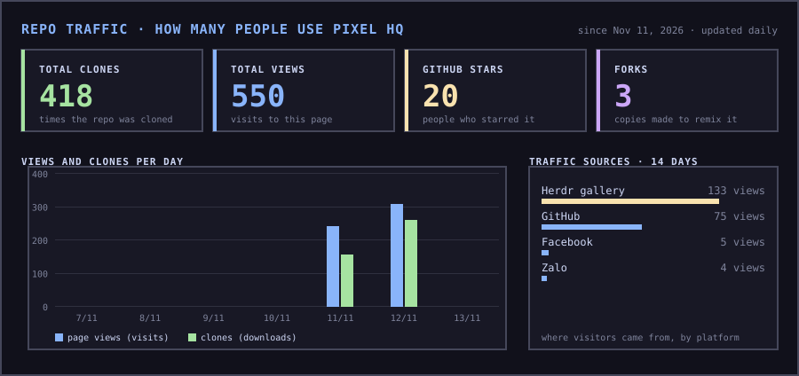
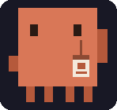
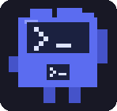
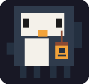
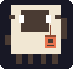
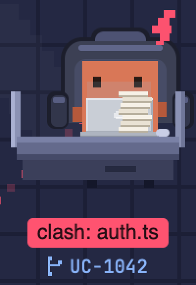
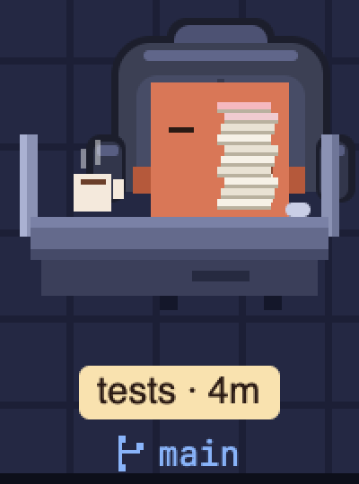

  <b>English</b> · <a href="README.vi.md">Tiếng Việt</a>

  

  A <a href="https://herdr.dev">Herdr</a> layout where your coding agents are a small engineering company. 
  Pixel pets at desks, chairs and MacBooks, in a dark Catppuccin night office.

  <b>Repo traffic</b>: how many people have viewed and cloned Pixel HQ (live GitHub numbers, updated every day) 
  

   
  The sidebar, live: floors with a status dot, pets typing at their desks and stepping out for a while on a break.

## What you get

- **Every space is a floor.** The Spaces list becomes floor cards: a small cut-away of the night office (a city window that lights up while someone is typing, an LED screen, one desk and one tiny pet per agent, a band in the space's color), the name, `branch · N aboard`, and a status dot: blue when someone is typing, pink when an agent needs you. The block is only as tall as its floors, so the office below gets the rest of the sidebar.
- **Every machine is a metro line.** Each machine gets its own colored line with a lettered badge (`WSL LINE`, `THIS COMPUTER LINE`) and its station count. Its spaces are stops on the track: the one you are in has a yellow stop, a little train waits above any stop where an agent is typing (its lamp blinks pink when an agent needs you), and the line ends in a `new station` stop that opens a new space on that machine. A machine that is away greys its line out. Drag a line by its header to put it where you want it, for example your WSL or server line on top: a grip shows on hover, the whole target line lights up as a drop zone, and the order is remembered. Right-click a line header to rename that machine in place (Enter saves, Esc cancels).
- **An office in your sidebar.** A night office with windows, a clock, a water cooler and LED screens with a hologram of the world. Every agent is a pixel pet on an office chair at its own desk, with a MacBook.
  Drag a pet to move its desk anywhere; click to jump to that agent. Add more agents and the desks shrink to fit, so everyone stays visible and readable.
- **Pets that live their day.** When an agent goes idle its pet mostly stays at the desk; every so often one steps out beside it, stands there for a while, and comes back. When work arrives it types. When an agent ships, pixel confetti rains over its desk until you look.
- **Desk nameplates on every pane.** The pane header shows the pet, its job title and a live status chip:
  `typing`, `needs you`, `shipped` or `on break`.
- **Find staff.** A search bar above the office: type a name, a job title (`reviewer`, `engineer`), a status (`typing`, `break`) or a space, and everyone who does not match fades out while matches get a yellow nameplate. Enter jumps to the first match.
- **A team status bar.** "Pixel HQ", how many agents are on the team, and how many are typing, blocked, shipped or on break.
- **A company sign.** The Pixel HQ corgi logo with "Pixel HQ / engineering floor" at the top of the sidebar.
- **A Catppuccin Mocha palette** with a soft blue accent, in a matching terminal theme.

## The team

One species per agent program, so you can tell who is who at a glance:

<table align="center">
  <tr>
    <td align="center"> <b>Claude Code</b> Staff Engineer</td>
    <td align="center"> <b>Codex</b> Code Reviewer</td>
    <td align="center"> <b>OpenCode</b> Platform Engineer</td>
  </tr>
  <tr>
    <td align="center"> <b>Antigravity (<code>agy</code>)</b> Systems Architect</td>
    <td align="center"> <b>anything else</b> the program's name</td>
  </tr>
</table>

| Program | Pet | Job title |
| --- | --- | --- |
| Claude Code | orange crab | Staff Engineer |
| Codex | blue terminal robot | Code Reviewer |
| OpenCode | penguin | Platform Engineer |
| Antigravity (`agy`) | little astronaut with a gradient cube head, orange arms and boots, its arch logo on the chest and on the laptop lid | Systems Architect |
| anything else | sheep | the program's name |

   
  (Animated.) The whole sidebar: three floors on the metro line, and the office with six staff in six states: a crab and a robot that changed the same file in two worktrees (red tags, dotted sparks), a crab typing, a penguin on a break, an astronaut typing and a crab that has shipped. Each sits in its own worktree, and the papers pile up as their context grows.

   
  Antigravity (<code>agy</code>) gets its own pet: a gradient cube head from red crown to teal, with its arch logo on the laptop lid and on the chest.

| Status | What the pet does |
| --- | --- |
| working | sits behind a MacBook with a glowing apple logo and types |
| needs you | waves a claw, a yellow `!` blinks beside it |
| shipped | claws up, hops, sparkles |
| idle | eyes closed, a mug of coffee steaming at the desk |

The pets, desks and room are drawn from rectangles and animated with Herdr's native `.loop()`. The only picture is the logo, and the only timer is a one-second tick that decides when a pet steps out.

## Install

Ask your agent:

> Read ~/.config/herdr-app/AGENTS.md, then add this layout: herdr.dev/layouts/bnhan2710/pixel-hq

Or by hand: copy `layouts/`, `mods/` and `themes/` into `~/.config/herdr-app/`, quit and reopen Herdr once,
then pick **pixel-hq** in Settings > Look. It brings its own **pixel-hq** theme, dark even when your system is in light mode.

Mods are trusted code and Herdr does not sandbox them. This repo is about 2,000 lines of JavaScript. The only programs it runs are local helpers
(`mkdir`, `cp`, `open`, `git` to see what each desk changed and to make worktrees when you hire, and Chrome/ImageMagick when you convert an animated picture in the figures editor). The one thing it writes outside its own folders is the OpenCode status plugin described below (only if OpenCode is installed, once, never overwriting). Its only network request is a tiny public file on GitHub (see "Update notices"). Read it before you install it.

## Update

Herdr installs a shared layout as a plain copy, so it does not update by itself. When a new version is out, Pixel HQ shows an **Update now** button in the office: it opens a new tab with an agent (the one you are in, else Claude) that starts on the prompt below. You can also ask any agent yourself:

> Read ~/.config/herdr-app/AGENTS.md, then update my Pixel HQ layout to the latest version from herdr.dev/layouts/bnhan2710/pixel-hq. Overwriting my installed pixel-hq files is intended; keep my other layouts and mods.

(Say "update": an agent never overwrites existing files unless you tell it to.) Then quit and reopen Herdr once if the window does not refresh.

What an update overwrites, and how to go back, is in [UPDATE.md](UPDATE.md).

## Papers on the desk

As an agent's context fills up, a pile of paper grows on its desk: one sheet per 10%, and past 80% the top sheets turn pink (past 95% the pile trembles). Hover it for the exact percentage. **Click the pile, then click it again within 6 seconds**, and Pixel HQ sends the agent `/compact`, which already summarizes the conversation and swaps the history for that summary. It only does this when the agent is idle: a working agent answers "busy: wait for it", a blocked one "answer it first". The first click just arms it and says so on the nameplate.

Herdr does not know how full an agent's context is, so each agent has its own way in:

- **Codex:** nothing to set up. Pixel HQ reads the token count Codex writes to its session file (`~/.codex/sessions`, found through the process that has it open, or by folder) every few seconds. macOS and Linux (it needs `sh` and `lsof`).
- **OpenCode (1.x):** nothing to set up either. The status plugin that Pixel HQ adds to OpenCode (see below) reports the last answer's tokens against the model's context window. OpenCode 2.x has no session events for a plugin to read, so no pile there yet.
- **Claude Code:** a status line has to tell Herdr. [`claude-statusline.sh`](mods/company-agents/claude-statusline.sh) does that (it labels the terminal with the context percentage); it needs `python3`. Ask your agent:

> Set my Claude Code status line (`statusLine` in `~/.claude/settings.json`) to `sh ~/.config/herdr-app/mods/company-agents/claude-statusline.sh`, keeping the rest of my settings. If I already have a status line, tell me first.

Antigravity (agy) has no pile yet: I found no way to read its context.

## Teamwork without collisions

- **One floor, one office.** Each space is its own office: the desks show only the agents of the space you are looking at (the other floors have their own cards).
- **Branch on every nameplate.** Under each desk's name tag is the branch its agent is on, with a small git-branch glyph.
- **Clash warnings.** Every few seconds Pixel HQ asks git what each desk has changed. If two worktrees of the same repo both changed the same file, both pets get a red lightning bolt and a red `clash: file` tag, and a dotted line of sparks joins their desks. If two agents are working in one and the same folder at the same time, they get an amber `same folder` tag instead.
- **Hire staff in their own worktree.** The **+** in the header opens a small form: a ticket name (say `UC-1234`), the repo folder and which agent to start. Pixel HQ runs `git worktree add -b UC-1234 <repo>/../.worktrees/<repo>-UC-1234` (or reuses the branch if it exists) and opens the agent there as a new tab of the current space, so two staff never share a working tree. Worktrees are not removed when the staff leaves; clean them with `git worktree remove`. If the folder is a workspace of several repos, the form tells you which ones are inside so you can type one.

  
   
  Left: a clash warning with the branch on the nameplate. Right: a nearly full context, the pink sheets on top.

## OpenCode in the office

Herdr only counts a program as an agent when it reports a status. Claude Code does, and so does OpenCode from 2.0.29 on. OpenCode 1.x does not, so on its own an OpenCode 1.x pane would get its pet in the header but no desk in the office. The first time the layout runs, if OpenCode is installed, it adds one small plugin ([`opencode-status.js`](mods/company-agents/opencode-status.js)) to OpenCode's plugins folder (`~/.config/opencode/plugins/`) that reports the status on 1.x and stays quiet on 2.x. It shows a note in the office, you restart OpenCode once, and OpenCode gets its desk. It never overwrites someone else's file, and it does this once only: delete the plugin file to remove it for good. The one exception is Pixel HQ's own first plugin, which OpenCode 2.x refuses to load ("1 plugin failed"): if that copy is there, it is replaced once with the current one. This works on macOS and Linux; Windows is supported through PowerShell but has not been tested on a real Windows machine yet, so please open an issue if OpenCode does not show up there.

## Update notices

When a newer version of Pixel HQ is out, the office shows a small note ("Pixel HQ 1.4.0 is out · what's new") with an **Update now** button (it opens an agent on the update prompt) and a **Later** button that hides it until the next version. To do this the `company-agents` mod reads one tiny public file, `mods/company-agents/version.json` on this repo's `main` branch, at start and every 6 hours, and compares it with the copy in your install. It sends nothing about you. To turn it off, delete `mods/company-agents/version.json` from your install (an update puts it back).

## Make it yours

- Right-click a pet to change its figures, or right-click empty floor to put every desk back.
- `RECIPE.md` is the brief this layout was built from. Hand it to your agent to rebuild or remix it.
- Drawings live in `mods/company-agents/duck.js` (the pets) and `scene.js` (the room).

## A real screenshot

   
  The whole office at work: two Claude, a Codex waiting for you and an OpenCode on a break, one git worktree each, with papers piling up on the desks (demo data only).

## Credits and license

MIT, see [LICENSE](LICENSE). Built on the **Pond Agents** mod by SimonBystromTableCheck (MIT) and Herdr's shipped mods and layouts (Apache-2.0).
Details in [NOTICE.md](NOTICE.md).
