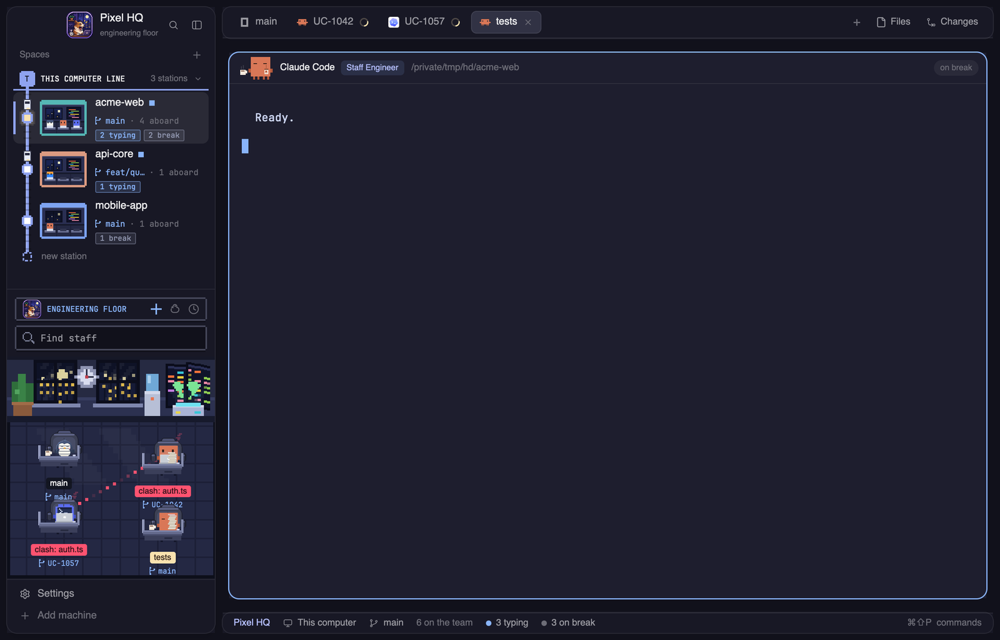

<h1 align="center">Agent Co.</h1>

  A <a href="https://herdr.dev">Herdr</a> layout where your coding agents are a small engineering company. 
  Pixel pets at desks, chairs and MacBooks, in a dark Catppuccin office.

  

   
  A real screenshot (demo data only).

## What you get

- **An office in your sidebar.** Every agent is a pixel pet sitting on an office chair at its own desk, with a MacBook.
  Drag a pet to move its desk anywhere; click to jump to that agent.
- **Desk nameplates on every pane.** The pane header shows the pet, its job title and a live status chip:
  `typing`, `needs you`, `shipped` or `on break`.
- **A team status bar.** "Agent Co. HQ", how many agents are on the team, and how many are typing, blocked, shipped or on break.
- **A company sign.** The Herdr logo with "Agent Co. / engineering floor" at the top of the sidebar.
- **A Catppuccin Mocha palette** with a soft blue accent, in a matching terminal theme.

## The team

One species per agent program, so you can tell who is who at a glance:

| Program | Pet | Job title |
| --- | --- | --- |
| Claude Code | orange crab | Staff Engineer |
| Codex | blue terminal robot | Code Reviewer |
| OpenCode | penguin | Platform Engineer |
| anything else | sheep | the program's name |

| Status | What the pet does |
| --- | --- |
| working | sits behind a MacBook with a glowing apple logo and types |
| needs you | waves a claw, a yellow `!` blinks beside it |
| shipped | claws up, hops, sparkles |
| idle | eyes closed, a mug of coffee steaming at the desk |

All of it is drawn from rectangles and animated with Herdr's native `.loop()`: no timers, no images.

## Install

Ask your agent:

> Read ~/.config/herdr-app/AGENTS.md, then add this layout: herdr.dev/layouts/bnhan2710/herdr-agent-co

Or by hand: copy `layouts/`, `mods/` and `themes/` into `~/.config/herdr-app/`, quit and reopen Herdr once,
then pick **company** in Settings > Look and the **company** theme.

Mods are trusted code and Herdr does not sandbox them. This repo is about 2,000 lines of JavaScript. It makes no network requests; the only programs it runs are local helpers
(`mkdir`, `cp`, `open`, and Chrome/ImageMagick when you convert an animated picture in the figures editor). Read it before you install it.

## Make it yours

- Right-click a pet to change its figures, or right-click empty floor to put every desk back.
- `RECIPE.md` is the brief this layout was built from. Hand it to your agent to rebuild or remix it.
- Drawings live in `mods/company-agents/duck.js` (the pets) and `scene.js` (the room).

## Credits and license

MIT, see [LICENSE](LICENSE). Built on the **Pond Agents** mod by SimonBystromTableCheck (MIT) and Herdr's shipped mods and layouts (Apache-2.0).
Details in [NOTICE.md](NOTICE.md).
