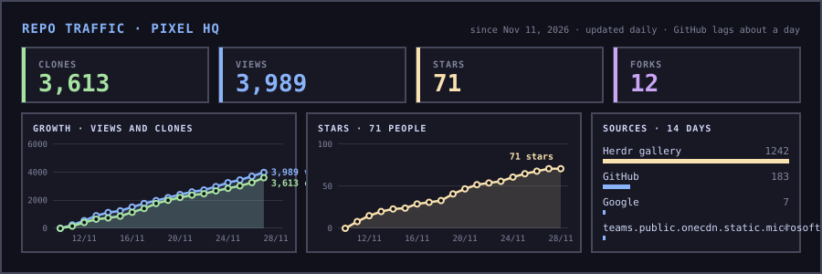
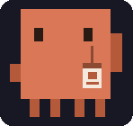
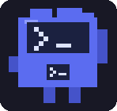
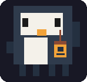
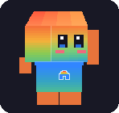
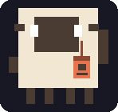
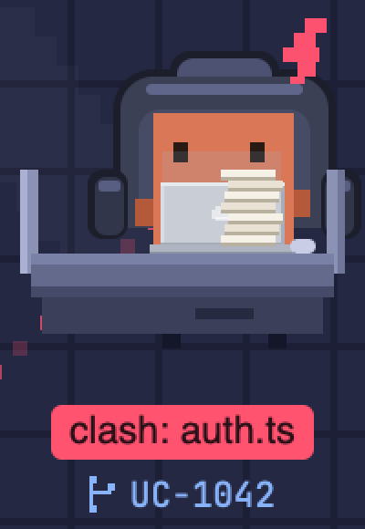
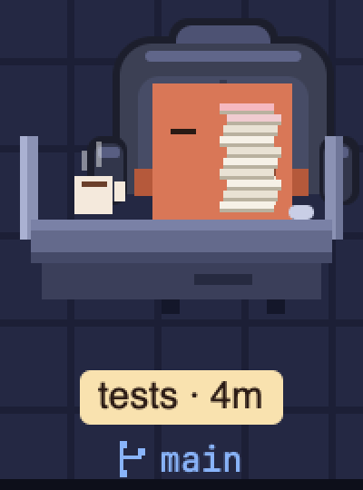

  <a href="README.md">English</a> · <b>Tiếng Việt</b>

  

  Một layout cho <a href="https://herdr.dev">Herdr</a>, nơi các coding agent của bạn là một công ty kỹ thuật nhỏ. 
  Thú cưng pixel ngồi ở bàn làm việc, có ghế và MacBook, trong một văn phòng ban đêm tông tối Catppuccin.

  

## Ảnh chụp thật

   
  Cả văn phòng đang làm việc: hai Claude Code, hai Codex (một con đang chờ bạn), một OpenCode và một Antigravity, mỗi agent một git worktree, giấy tờ chất dần trên bàn (dữ liệu demo).

   
  Sidebar đang chạy: các tầng có chấm trạng thái, thú cưng gõ phím ở bàn và thỉnh thoảng đứng dậy nghỉ giải lao một lúc.

## Bạn có gì

- **Mỗi space là một tầng.** Danh sách Spaces trở thành các thẻ tầng: một lát cắt nhỏ của văn phòng ban đêm (ô cửa sổ nhìn ra thành phố sáng đèn khi có ai đang gõ phím, một màn hình LED, mỗi agent có một bàn và một thú cưng tí hon, một dải màu theo màu của space), tên, `branch · N aboard` và một chấm trạng thái: xanh dương khi có ai đang gõ, hồng khi có agent cần bạn. Khối này chỉ cao đúng bằng số tầng, nên phần còn lại của sidebar dành cho văn phòng bên dưới.
- **Mỗi máy là một tuyến tàu điện.** Mỗi máy có một tuyến màu riêng, với huy hiệu chữ cái (`WSL LINE`, `THIS COMPUTER LINE`) và số ga. Các space là ga trên tuyến: ga bạn đang ở có điểm dừng màu vàng, một đoàn tàu nhỏ chờ phía trên ga có agent đang gõ (đèn tàu nháy hồng khi có agent cần bạn), và tuyến kết thúc ở ga `new station` để mở space mới trên máy đó. Máy mất kết nối thì tuyến chuyển sang màu xám. Kéo tiêu đề của một tuyến để đặt nó ở vị trí bạn muốn, ví dụ đưa tuyến WSL hoặc server lên đầu: rê chuột sẽ hiện tay cầm, cả tuyến đích sáng lên làm vùng thả, và thứ tự được ghi nhớ. Click chuột phải vào tiêu đề tuyến để đổi tên máy ngay tại chỗ (Enter để lưu, Esc để huỷ).
- **Một văn phòng ngay trong sidebar.** Văn phòng ban đêm có cửa sổ, đồng hồ, cây nước và một tủ server nhấp nháy đèn và một chiếc bàn nhỏ với màn hình đang mở trình soạn code. Mỗi agent là một thú cưng pixel ngồi ghế văn phòng ở bàn riêng, kèm một chiếc MacBook.
  Kéo thả thú cưng để dời bàn của nó đi bất cứ đâu; bấm vào để nhảy tới agent đó. Thêm agent thì bàn tự thu nhỏ cho vừa, nên ai cũng vẫn hiện ra và dễ nhìn.
- **Thú cưng sống trọn ngày của mình.** Khi agent rảnh, thú cưng phần lớn ngồi yên ở bàn; thỉnh thoảng một con đứng dậy ra cạnh bàn, đứng đó một lúc rồi quay lại. Khi idle quá 2 phút, nó ngủ gật với những chữ Zzz lơ lửng; sau 5 phút chiếc đồng hồ báo thức pixel rung chuông giục làm việc. Cả hai mốc đều tính từ lần cuối bạn xem agent đó, nên mở nó ra rồi rời đi mà không giao việc thì nó quay lại nghỉ cà phê bình thường. Click vào thú cưng bất kỳ lúc nào để đánh thức nó ("nudge"). Có việc là nó gõ phím. Khi agent ship xong, pháo giấy pixel rơi xuống bàn nó cho tới khi bạn ghé nhìn.
- **Bảng tên trên mọi pane.** Header của pane hiện thú cưng, chức danh và một chip trạng thái trực tiếp:
  `typing`, `needs you`, `shipped` hoặc `on break`.
- **Chỉ số HP và SP.** Dưới bảng tên của mỗi bàn là hai thanh mỏng. **HP** là mức context đã dùng, tô màu như status line của Claude: xanh lá, vàng từ 60%, đỏ từ 80%. **SP** là phần quota window còn lại: xanh dương khi còn nhiều, hổ phách từ 30%, đỏ từ 10%. Di chuột lên bàn để xem con số chính xác. Model và mức effort của nó hiện trên dòng branch (`main · Opus 5.5 · high`). Codex không có nguồn quota, nên bàn của Codex chỉ có thanh HP và chồng giấy; SP của Antigravity đọc từ usage API của agy (cục bộ, tự refresh token).
- **Cần bạn, chỉ một danh sách.** Ngay khi có agent ở bất kỳ tầng hay máy nào chờ bạn, một chiếc chuông pixel hiện lên trong header kèm số đếm (pill `N need you` trên thanh trạng thái cũng mở danh sách đó, và trên macOS badge Dock hiển thị con số). Click vào: hộp "needs-you" liệt kê mọi agent đang chờ trên mọi space và máy, lâu nhất trước — thú cưng, tiêu đề terminal, tầng làm việc, chương trình và đã chờ bao lâu. Click một dòng là nhảy thẳng tới pane của nó.
- **Nhân viên đã ship có thể "clock out".** Mỗi bàn ship xong được một nút `✓` xanh lá ở góc trên-trái. Click vào, pet sẽ được "settle" tới khi nhận task tiếp theo: bàn biến mất khỏi tầng và pháo giấy dừng rơi. Nó tự quay lại ngay khi nó hoạt động hoặc cần bạn, và một chip `✓ N settled` trong văn phòng mang mọi người trở lại cùng lúc.
- **Tìm nhân viên.** Ô tìm kiếm phía trên văn phòng: gõ tên, chức danh (`reviewer`, `engineer`), trạng thái (`typing`, `break`) hoặc tên space, ai không khớp sẽ mờ đi còn ai khớp sẽ có bảng tên màu vàng. Nhấn Enter để nhảy tới kết quả đầu tiên.
- **Pixel MusicBox & Đài Radio.** Chiếc đài retro nhỏ nhắn nằm ở góc công nghệ trong văn phòng, các nốt nhạc pixel `♪ ♫` bay lên lơ lửng khi đang phát nhạc. Nhấp chuột vào chiếc đài hoặc nút `📻 MusicBox` trên thanh trạng thái để mở MusicBox: dán link YouTube, SoundCloud hoặc luồng audio trực tiếp (.mp3, .m3u8, radio Icecast) hoặc chọn nhanh từ các đài chill có sẵn (SomaFM, Nightwave Plaza, DEF CON Radio). Phát luồng audio ngầm qua `ffplay` hoặc `mpv` mà không mở trình duyệt hay dựng hình video, siêu nhẹ.
- **Thanh trạng thái của team.** "Pixel HQ", team có bao nhiêu agent, và bao nhiêu agent đang gõ, đang chờ bạn, đã ship hoặc đang nghỉ giải lao.
- **Biển hiệu công ty.** Logo chú corgi của Pixel HQ cùng dòng "Pixel HQ / engineering floor" ở đầu sidebar.
- **Bảng màu Catppuccin Mocha** với điểm nhấn xanh dương dịu, đi kèm một theme terminal cùng tông.

## Đội ngũ

Mỗi chương trình agent là một loài, để bạn nhìn qua là biết ai là ai:

<table align="center">
  <tr>
    <td align="center"> <b>Claude Code</b> Staff Engineer</td>
    <td align="center"> <b>Codex</b> Code Reviewer</td>
    <td align="center"> <b>OpenCode</b> Platform Engineer</td>
  </tr>
  <tr>
    <td align="center"> <b>Antigravity (<code>agy</code>)</b> Systems Architect</td>
    <td align="center"> <b>chương trình khác</b> tên của chương trình</td>
  </tr>
</table>

| Chương trình | Thú cưng | Chức danh |
| --- | --- | --- |
| Claude Code | cua cam | Staff Engineer |
| Codex | robot terminal xanh dương | Code Reviewer |
| OpenCode | chim cánh cụt | Platform Engineer |
| Antigravity (`agy`) | phi hành gia nhỏ có đầu hình khối màu gradient, tay và ủng màu cam, logo vòm của nó trên ngực và trên nắp laptop | Systems Architect |
| chương trình khác | cừu | tên của chương trình |

   
  (Ảnh động.) Cả sidebar: ba tầng trên đường tàu và văn phòng với sáu nhân viên, sáu trạng thái: một chú cua và robot cùng sửa một file ở hai worktree (thẻ đỏ, tia lửa chấm), một chú cua đang gõ, chim cánh cụt đang nghỉ, phi hành gia đang gõ và một chú cua đã xong việc. Mỗi người ở một worktree riêng, giấy tờ chất dần theo context.

   
  Antigravity (<code>agy</code>) có thú cưng riêng: đầu hình khối chuyển màu từ đỉnh đỏ xuống xanh ngọc, logo vòm trên nắp laptop và trên ngực.

| Trạng thái | Thú cưng làm gì |
| --- | --- |
| working | ngồi sau chiếc MacBook có logo quả táo phát sáng và gõ phím |
| needs you | vẫy càng, một dấu `!` màu vàng nhấp nháy bên cạnh |
| shipped | giơ càng lên, nhảy tưng tưng, lấp lánh |
| idle | nhắm mắt uống cà phê; ngủ gật với chữ Zzz lơ lửng sau 2 phút; chuông báo thức pixel rung giục làm việc sau 5 phút; cả hai đếm lại khi bạn xem agent (click để đánh thức/nudge) |

Thú cưng, bàn và căn phòng đều được vẽ từ các hình chữ nhật và tạo chuyển động bằng `.loop()` gốc của Herdr. Hình ảnh duy nhất là logo, và bộ đếm giờ duy nhất là một nhịp một giây quyết định khi nào thú cưng đứng dậy ra ngoài.

## Cài đặt

Nhờ agent của bạn:

> Read ~/.config/herdr-app/AGENTS.md, then add this layout: herdr.dev/layouts/bnhan2710/pixel-hq

Hoặc làm tay: chép `layouts/`, `mods/` và `themes/` vào `~/.config/herdr-app/`, thoát rồi mở lại Herdr một lần,
sau đó chọn **pixel-hq** trong Settings > Look. Layout tự mang theme **pixel-hq**, luôn tối kể cả khi hệ thống đang ở chế độ sáng.

Mod là code được tin cậy và Herdr không chạy chúng trong sandbox. Repo này có khoảng 4.200 dòng JavaScript. Các chương trình duy nhất nó chạy là các công cụ cục bộ
(`mkdir`, `cp`, `open`, `git` để xem mỗi bàn đã sửa gì và tạo worktree khi bạn thuê staff, và Chrome/ImageMagick khi bạn chuyển đổi ảnh động trong trình chỉnh figures). Điều duy nhất nó ghi ra ngoài thư mục của mình là plugin trạng thái OpenCode ở mục bên dưới (chỉ khi máy có OpenCode, một lần, không ghi đè). Nó chỉ kết nối tới GitHub: phần kiểm tra cập nhật đọc một file công khai rất nhỏ, còn khi bạn bấm **Update now** thì nó tải các file của repo này (xem "Cập nhật"). Nó không gửi gì về bạn. Hãy đọc code trước khi cài.

## Cập nhật

Herdr cài layout chia sẻ dưới dạng bản sao thường, nên nó không tự cập nhật. Khi có phiên bản mới, Pixel HQ hiện nút **Update now** trong văn phòng. Nút này mở một cửa sổ nhỏ, tải thẳng từ GitHub các file mới nhất trên nhánh `main` của repo này (danh sách file lấy từ GitHub API, nếu lỗi thì dùng danh sách có sẵn), hiện tiến độ, rồi chỉ ghi đè những file Pixel HQ đã thay đổi trong bản cài: `layouts/pixel-hq.json`, `themes/pixel-hq.json` và các mod `company-*`. Không cần agent nào. Nó luôn cài bản mới nhất, kể cả khi bạn đã bỏ qua vài bản. Nếu tải lỗi, cửa sổ có nút **Retry Auto-Update** hoặc **Use Agent Tab**: nút sau mở tab mới với một agent (agent bạn đang dùng, nếu không thì Claude) chạy câu lệnh bên dưới. Bạn cũng có thể tự nhờ một agent bất kỳ:

> Read ~/.config/herdr-app/AGENTS.md, then update my Pixel HQ layout to the latest version from herdr.dev/layouts/bnhan2710/pixel-hq. Overwriting my installed pixel-hq files is intended; keep my other layouts and mods.

(Nhớ nói "update": agent không bao giờ ghi đè file có sẵn nếu bạn không bảo nó.) Sau đó thoát và mở lại Herdr một lần nếu cửa sổ chưa làm mới.

Những gì cập nhật sẽ ghi đè và cách quay lại bản cũ nằm trong [UPDATE.md](UPDATE.md) (tiếng Anh).

## Giấy tờ trên bàn

Khi context của agent đầy lên, một chồng giấy cao dần trên bàn của nó: cứ 10% thêm một tờ, quá 80% mấy tờ trên cùng ngả hồng (quá 95% chồng giấy rung). Cùng phần trăm đó cũng nuôi thanh HP (xem "Chỉ số HP và SP" ở trên). Rê chuột lên để xem phần trăm chính xác. **Bấm vào chồng giấy, rồi bấm lần nữa trong 6 giây**, Pixel HQ sẽ gửi cho agent lệnh `/compact`, vốn đã tự tóm tắt cuộc trò chuyện rồi thay lịch sử bằng bản tóm tắt. Chỉ làm khi agent đang rảnh: agent đang chạy sẽ báo "busy: wait for it", agent đang chờ bạn trả lời báo "answer it first". Lần bấm đầu chỉ lên cò và hiện lời nhắc trên biển tên.

Herdr không biết context của agent đầy bao nhiêu, nên mỗi agent có một đường riêng:

- **Codex:** không cần cài gì. Pixel HQ đọc số token mà Codex ghi vào file phiên của nó (`~/.codex/sessions`, tìm qua tiến trình đang mở file đó, hoặc theo thư mục) mỗi vài giây. Chạy trên macOS và Linux (cần `sh` và `lsof`).
- **OpenCode:** cũng không cần cài gì. Pixel HQ báo số token của câu trả lời gần nhất so với cửa sổ context của model, trên cả 1.x lẫn 2.x, từ một TUI plugin duy nhất ([`opencode-hp/`](mods/company-agents/opencode-hp/), một directory package trong `~/.config/opencode/plugins/` — mọi TUI đang chạy tự phát hiện, tự nạp lại khi file đổi): 1.x nạp export `tui`, 2.x nạp `setup`; riêng 1.x còn có đường dự phòng trong status plugin. OpenCode không có nguồn quota gói được công bố ở đây, nên bàn OpenCode chỉ có thanh HP và chồng giấy, không có bar SP.
- **Claude Code:** cần status line báo cho Herdr. [`claude-statusline.sh`](mods/company-agents/claude-statusline.sh) làm việc đó (gắn nhãn phần trăm context, phần cửa sổ 5 giờ còn lại và mức effort cho terminal); cần `python3`. Nhờ agent của bạn:

> Set my Claude Code status line (`statusLine` in `~/.claude/settings.json`) to `sh ~/.config/herdr-app/mods/company-agents/claude-statusline.sh`, keeping the rest of my settings. If I already have a status line, tell me first.

- **Antigravity (`agy`):** không cần cài gì. Pixel HQ đọc file transcript cuộc trò chuyện trong `~/.gemini/antigravity-cli/brain/` (tìm hội thoại gần nhất của workspace trong `history.jsonl`) và tính số token (`input_tokens + cache_read_tokens`) so với cửa sổ context 1M token mỗi vài giây — đó là HP. SP đọc phần quota còn lại của gói từ đúng usage API mà `agy` CLI dùng (token ở `~/.gemini/antigravity-cli/antigravity-oauth-token`, tự refresh; `AGY_HOME` được tôn trọng với cài đặt lạ) và hiện ra bucket model eo hẹp nhất ([`agy-quota.py`](mods/company-agents/agy-quota.py)). macOS, Linux và Windows (SP cần `python3` hoặc `python`; script không mang credential riêng — nó đọc public OAuth pair từ chính binary `agy` đã cài và cache lại trong `~/.cache/pixel-hq/`).

## Làm việc nhóm không giẫm chân nhau

- **Mỗi tầng một văn phòng.** Mỗi space là một văn phòng riêng: các bàn chỉ hiện agent của space bạn đang xem (các tầng khác có thẻ riêng).
- **Branch trên mọi biển tên.** Dưới tên mỗi bàn là branch mà agent đang ở, kèm biểu tượng git-branch nhỏ.
- **Cảnh báo đụng nhau.** Cứ vài giây Pixel HQ hỏi git xem mỗi bàn đã sửa gì. Nếu hai worktree của cùng một repo cùng sửa một file, hai pet đều có tia sét đỏ và thẻ đỏ `clash: file`, và một đường tia lửa chấm nối hai bàn lại. Nếu hai agent cùng làm việc trong một thư mục tại cùng lúc, chúng có thẻ vàng `same folder`.
- **Thuê staff trong worktree riêng.** Dấu **+** ở tiêu đề mở một form nhỏ: tên ticket (ví dụ `UC-1234`), thư mục repo và agent nào sẽ chạy. Pixel HQ chạy `git worktree add -b UC-1234 <repo>/../.worktrees/<repo>-UC-1234` (hoặc dùng lại branch nếu đã có) và mở agent ở đó như một tab mới của space hiện tại, nên hai staff không bao giờ dùng chung một cây làm việc. Worktree không bị xóa khi staff rời đi; dọn bằng `git worktree remove`. Nếu thư mục là workspace chứa nhiều repo, form sẽ cho bạn biết có những repo nào để bạn gõ đường dẫn một repo.

  
   
  Trái: cảnh báo clash kèm branch trên biển tên. Phải: context gần đầy, mấy tờ hồng nằm trên cùng.

## OpenCode trong văn phòng

Herdr chỉ coi một chương trình là agent khi nó báo trạng thái. Claude Code tự báo, OpenCode từ bản 2.0.29 cũng tự báo. OpenCode 1.x thì không, nên nếu không có gì hỗ trợ thì pane OpenCode 1.x chỉ có pet ở header mà không có bàn trong văn phòng. Lần đầu layout chạy, nếu máy có OpenCode, nó thêm một plugin nhỏ ([`opencode-status.js`](mods/company-agents/opencode-status.js)) vào thư mục plugin của OpenCode (`~/.config/opencode/plugins/`): trên 1.x plugin báo trạng thái, trên 2.x thì đứng yên. Cùng lần chạy đó, nó cũng thêm [`opencode-hp/`](mods/company-agents/opencode-hp/) vào đó, một TUI plugin (directory package) giữ thanh HP của bàn khớp với cửa sổ context trên cả 1.x lẫn 2.x; mọi TUI đang chạy tự nạp trong vài giây. Văn phòng hiện một dòng thông báo, bạn mở lại OpenCode một lần là OpenCode có bàn. Các plugin không bao giờ ghi đè file của người khác và chỉ làm một lần mỗi cái: xóa file plugin (hoặc thư mục plugin) là gỡ hẳn. Ngoại lệ duy nhất là bản plugin đầu tiên của chính Pixel HQ, bản mà OpenCode 2.x từ chối nạp ("1 plugin failed"): nếu còn bản đó, nó được thay một lần bằng bản hiện tại. Cách này chạy trên macOS và Linux; Windows được hỗ trợ qua PowerShell nhưng chưa được thử trên máy Windows thật, nếu OpenCode không hiện ở đó bạn hãy mở issue giúp mình.

## Thông báo cập nhật

Khi có phiên bản Pixel HQ mới, văn phòng hiện một dòng nhỏ ("Pixel HQ 1.4.0 is out · có gì mới") kèm nút **Update now** (tải và cài các file mới, xem "Cập nhật") và nút **Later** để ẩn đến phiên bản kế tiếp. Để làm vậy, mod `company-agents` đọc một file công khai rất nhỏ, `mods/company-agents/version.json` trên nhánh `main` của repo này, lúc khởi động và mỗi 6 giờ, rồi so với bản trong máy bạn. Nó không gửi gì về bạn. Muốn tắt, xóa `mods/company-agents/version.json` trong bản cài của bạn (cập nhật sẽ đặt nó lại).

## Tuỳ biến theo ý bạn

- Chuột phải vào một thú cưng để đổi figures của nó, hoặc chuột phải vào chỗ sàn trống để đưa mọi bàn về chỗ cũ.
- `RECIPE.md` là bản brief dùng để dựng layout này. Đưa nó cho agent của bạn để dựng lại hoặc remix.
- Phần vẽ nằm ở `mods/company-agents/duck.js` (thú cưng) và `scene.js` (căn phòng).

## Ghi công và giấy phép

MIT, xem [LICENSE](LICENSE). Xây dựng dựa trên mod **Pond Agents** của SimonBystromTableCheck (MIT) cùng các mod và layout đi kèm Herdr (Apache-2.0).
Chi tiết trong [NOTICE.md](NOTICE.md).
