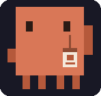
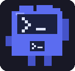
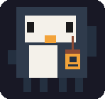
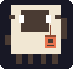

  <a href="README.md">English</a> · <b>Tiếng Việt</b>

  

  Một layout cho <a href="https://herdr.dev">Herdr</a>, nơi các coding agent của bạn là một công ty kỹ thuật nhỏ. 
  Thú cưng pixel ngồi ở bàn làm việc, có ghế và MacBook, trong một văn phòng ban đêm tông tối Catppuccin.

   
  Sidebar đang chạy: các tầng có chấm trạng thái, thú cưng gõ phím ở bàn và thỉnh thoảng đứng dậy nghỉ giải lao một lúc.

## Bạn có gì

- **Mỗi space là một tầng.** Danh sách Spaces trở thành các thẻ tầng: một lát cắt nhỏ của văn phòng ban đêm (ô cửa sổ nhìn ra thành phố sáng đèn khi có ai đang gõ phím, một màn hình LED, mỗi agent có một bàn và một thú cưng tí hon, một dải màu theo màu của space), tên, `branch · N aboard` và một chấm trạng thái: xanh dương khi có ai đang gõ, hồng khi có agent cần bạn. Khối này chỉ cao đúng bằng số tầng, nên phần còn lại của sidebar dành cho văn phòng bên dưới.
- **Mỗi máy là một tuyến tàu điện.** Mỗi máy có một tuyến màu riêng, với huy hiệu chữ cái (`WSL LINE`, `THIS COMPUTER LINE`) và số ga. Các space là ga trên tuyến: ga bạn đang ở có điểm dừng màu vàng, một đoàn tàu nhỏ chờ phía trên ga có agent đang gõ (đèn tàu nháy hồng khi có agent cần bạn), và tuyến kết thúc ở ga `new station` để mở space mới trên máy đó. Máy mất kết nối thì tuyến chuyển sang màu xám. Kéo tiêu đề của một tuyến để đặt nó ở vị trí bạn muốn, ví dụ đưa tuyến WSL hoặc server lên đầu: rê chuột sẽ hiện tay cầm, cả tuyến đích sáng lên làm vùng thả, và thứ tự được ghi nhớ. Click chuột phải vào tiêu đề tuyến để đổi tên máy ngay tại chỗ (Enter để lưu, Esc để huỷ).
- **Một văn phòng ngay trong sidebar.** Văn phòng ban đêm có cửa sổ, đồng hồ, cây nước và các màn hình LED chiếu hologram quả địa cầu. Mỗi agent là một thú cưng pixel ngồi ghế văn phòng ở bàn riêng, kèm một chiếc MacBook.
  Kéo thả thú cưng để dời bàn của nó đi bất cứ đâu; bấm vào để nhảy tới agent đó. Thêm agent thì bàn tự thu nhỏ cho vừa, nên ai cũng vẫn hiện ra và dễ nhìn.
- **Thú cưng sống trọn ngày của mình.** Khi agent rảnh, thú cưng phần lớn ngồi yên ở bàn; thỉnh thoảng một con đứng dậy ra cạnh bàn, đứng đó một lúc rồi quay lại. Có việc là nó gõ phím. Khi agent ship xong, pháo giấy pixel rơi xuống bàn nó cho tới khi bạn ghé nhìn.
- **Bảng tên trên mọi pane.** Header của pane hiện thú cưng, chức danh và một chip trạng thái trực tiếp:
  `typing`, `needs you`, `shipped` hoặc `on break`.
- **Tìm nhân viên.** Ô tìm kiếm phía trên văn phòng: gõ tên, chức danh (`reviewer`, `engineer`), trạng thái (`typing`, `break`) hoặc tên space, ai không khớp sẽ mờ đi còn ai khớp sẽ có bảng tên màu vàng. Nhấn Enter để nhảy tới kết quả đầu tiên.
- **Thanh trạng thái của team.** "Pixel HQ", team có bao nhiêu agent, và bao nhiêu agent đang gõ, đang chờ bạn, đã ship hoặc đang nghỉ giải lao.
- **Biển hiệu công ty.** Logo chú corgi của Pixel HQ cùng dòng "Pixel HQ / engineering floor" ở đầu sidebar.
- **Bảng màu Catppuccin Mocha** với điểm nhấn xanh dương dịu, đi kèm một theme terminal cùng tông.

## Đội ngũ

Mỗi chương trình agent là một loài, để bạn nhìn qua là biết ai là ai:

<table align="center">
  <tr>
    <td align="center"> <b>Claude Code</b> Staff Engineer</td>
    <td align="center"> <b>Codex</b> Code Reviewer</td>
    <td align="center"> <b>OpenCode</b> Platform Engineer</td>
  </tr>
  <tr>
    <td align="center"> <b>Antigravity (<code>agy</code>)</b> Systems Architect</td>
    <td align="center"> <b>chương trình khác</b> tên của chương trình</td>
  </tr>
</table>

| Chương trình | Thú cưng | Chức danh |
| --- | --- | --- |
| Claude Code | cua cam | Staff Engineer |
| Codex | robot terminal xanh dương | Code Reviewer |
| OpenCode | chim cánh cụt | Platform Engineer |
| Antigravity (`agy`) | phi hành gia nhỏ có đầu hình khối màu gradient, tay và ủng màu cam, logo vòm của nó trên ngực và trên nắp laptop | Systems Architect |
| chương trình khác | cừu | tên của chương trình |

   
  Bốn nhân viên ở bàn: hai chú cua Claude, một chim cánh cụt OpenCode và một robot Codex (robot đang chờ bạn).

   
  Antigravity (<code>agy</code>) có thú cưng riêng: đầu hình khối chuyển màu từ đỉnh đỏ xuống xanh ngọc, logo vòm trên nắp laptop và trên ngực.

| Trạng thái | Thú cưng làm gì |
| --- | --- |
| working | ngồi sau chiếc MacBook có logo quả táo phát sáng và gõ phím |
| needs you | vẫy càng, một dấu `!` màu vàng nhấp nháy bên cạnh |
| shipped | giơ càng lên, nhảy tưng tưng, lấp lánh |
| idle | nhắm mắt, cốc cà phê bốc khói trên bàn |

Thú cưng, bàn và căn phòng đều được vẽ từ các hình chữ nhật và tạo chuyển động bằng `.loop()` gốc của Herdr. Hình ảnh duy nhất là logo, và bộ đếm giờ duy nhất là một nhịp một giây quyết định khi nào thú cưng đứng dậy ra ngoài.

## Ảnh chụp thật

   
  Layout khi đang chạy (chỉ dữ liệu demo).

## Cài đặt

Nhờ agent của bạn:

> Read ~/.config/herdr-app/AGENTS.md, then add this layout: herdr.dev/layouts/bnhan2710/pixel-hq

Hoặc làm tay: chép `layouts/`, `mods/` và `themes/` vào `~/.config/herdr-app/`, thoát rồi mở lại Herdr một lần,
sau đó chọn **pixel-hq** trong Settings > Look. Layout tự mang theme **pixel-hq**, luôn tối kể cả khi hệ thống đang ở chế độ sáng.

Mod là code được tin cậy và Herdr không chạy chúng trong sandbox. Repo này có khoảng 2.000 dòng JavaScript. Nó không gửi request mạng nào; các chương trình duy nhất nó chạy là các công cụ cục bộ
(`mkdir`, `cp`, `open`, và Chrome/ImageMagick khi bạn chuyển đổi ảnh động trong trình chỉnh figures). Hãy đọc code trước khi cài.

## Cập nhật

Herdr cài layout chia sẻ dưới dạng bản sao thường, nên nó không tự cập nhật. Chỉ cần nhờ agent của bạn:

> Read ~/.config/herdr-app/AGENTS.md, then update my Pixel HQ layout to the latest version from herdr.dev/layouts/bnhan2710/pixel-hq. Overwriting my installed pixel-hq files is intended; keep my other layouts and mods.

(Nhớ nói "update": agent không bao giờ ghi đè file có sẵn nếu bạn không bảo nó.) Sau đó thoát và mở lại Herdr một lần nếu cửa sổ chưa làm mới.

Những gì cập nhật sẽ ghi đè và cách quay lại bản cũ nằm trong [UPDATE.md](UPDATE.md) (tiếng Anh).

## OpenCode trong văn phòng

Herdr chỉ coi một chương trình là agent khi nó báo trạng thái. Claude Code tự báo, OpenCode từ bản 2.0.29 cũng tự báo. OpenCode 1.x thì không, nên nếu không có gì hỗ trợ thì pane OpenCode 1.x chỉ có pet ở header mà không có bàn trong văn phòng. Lần đầu layout chạy, nếu máy có OpenCode, nó thêm một plugin nhỏ ([`opencode-status.js`](mods/company-agents/opencode-status.js)) vào thư mục plugin của OpenCode (`~/.config/opencode/plugins/`): trên 1.x plugin báo trạng thái, trên 2.x thì đứng yên. Văn phòng hiện một dòng thông báo, bạn mở lại OpenCode một lần là OpenCode có bàn. Nó không bao giờ ghi đè file của người khác và chỉ làm một lần: xóa file plugin là gỡ hẳn. Ngoại lệ duy nhất là bản plugin đầu tiên của chính Pixel HQ, bản mà OpenCode 2.x từ chối nạp ("1 plugin failed"): nếu còn bản đó, nó được thay một lần bằng bản hiện tại. Cách này chạy trên macOS và Linux; Windows được hỗ trợ qua PowerShell nhưng chưa được thử trên máy Windows thật, nếu OpenCode không hiện ở đó bạn hãy mở issue giúp mình.

## Tuỳ biến theo ý bạn

- Chuột phải vào một thú cưng để đổi figures của nó, hoặc chuột phải vào chỗ sàn trống để đưa mọi bàn về chỗ cũ.
- `RECIPE.md` là bản brief dùng để dựng layout này. Đưa nó cho agent của bạn để dựng lại hoặc remix.
- Phần vẽ nằm ở `mods/company-agents/duck.js` (thú cưng) và `scene.js` (căn phòng).
- Trước khi mở pull request, chạy `node scripts/check.mjs` (Node 22 trở lên). CI chạy đúng các kiểm tra này: cú pháp JavaScript, JSON và SVG hợp lệ, không còn dấu conflict khi merge hay file do `herdr-app check` để lại, mọi file `mods/<mod>/…` mà mod trỏ tới đều có, cùng các mod và theme mà layout dùng. Nó không thay được `herdr-app check` và việc chạy thử layout trong Herdr.

## Ghi công và giấy phép

MIT, xem [LICENSE](LICENSE). Xây dựng dựa trên mod **Pond Agents** của SimonBystromTableCheck (MIT) cùng các mod và layout đi kèm Herdr (Apache-2.0).
Chi tiết trong [NOTICE.md](NOTICE.md).
