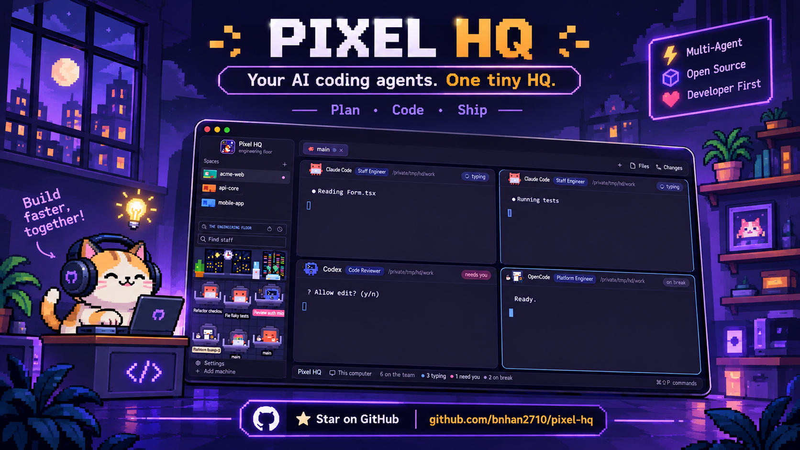

# Pixel HQ

Your coding agents as a small engineering company. Each agent is a pixel pet sitting on a chair
at its own desk with a MacBook, in a dark office. Its pane header is a desk nameplate with
its job title. Typing, on a break, shipped, needs you: all drawn.

This file is the brief: enough to build Pixel HQ from an empty folder. The files next to it are
one build of it. If they don't work on your Herdr, or you want it different, build it again from here.

## What you see

The Herdr window in a Catppuccin Mocha palette: dark blue-gray panels, light text, a soft blue `#89b4fa`
as the one accent. Panels are rounded (14px) with a faint white 1px border. A sidebar on the left,
tabs and terminals on the right, a status bar at the bottom.

- **Brand block** (top of the sidebar, 46px): the Pixel HQ logo (`mods/company-brand/logo.png`, a pixel-art corgi at a laptop in a rounded purple frame, 34px, transparent corners), "Pixel HQ"
  in semibold 14px and under it "engineering floor" in dim 10px. Search and sidebar-toggle buttons on the right.
- **Floors** (the spaces block, header "Spaces" with a + button): each top-level space is one floor, a 52px card (rounded 8, no outline).
  - Tile (54x40, rounded 6, 1px dark outline): a cut-away of one floor of the night office. Slate wall (a touch lighter while the floor has staff, `#2a2f52`) with a 3px band in the space's color (the one Herdr stores in `space.colors`) along the top, a window with a city skyline, a moon and a few lit panes (brighter while an agent in the space is typing), a small LED screen of colored code lines (some blink while someone types), and a tiled floor with one desk per agent, up to three: a chair, a 8x7 pet in its own colors (crab orange, robot blue, penguin dark with a white belly, Antigravity orange over blue, other agents cream) and a laptop that glows white. A blocked agent's laptop glows pink with a blinking amber `!`; a done agent gets green and yellow sparkles. Empty desks show a dark laptop.
  - Line 1: the space name, semibold. Line 2, dim 11px: the git branch (or the folder name without git), a dot, and "N staff" or "empty",
    then green up and red down arrows for ahead and behind.
  - Right edge: one 8px dot. Blue while someone is typing, pink and softly pulsing when an agent needs you, nothing otherwise.
  - The active floor gets the shipped selected background. Worktree spaces keep the shipped compact tree rows; drag to reorder, the right-click menu
    and the collapsed rail work as in the shipped mod.
  - The mod resizes its own block (`layout.resize`) to `31 + floors x 54 + 20` px, between 100 and 380, plus 56 per remote machine, so the
    office gets the rest; more floors than fit scroll. The layout file starts it at 104px.
- **Pixel header and search** (above the office): a 30px plaque with a notched 2px frame (`#45475a`, corners cut) on a `#181825` fill and a hard 2px `#11111b` shadow below. It holds the corgi logo (24px, the same `logo.png`), "ENGINEERING FLOOR" in JetBrains Mono bold 10px caps in `#89b4fa`, then the figures and sort buttons.
- **Find staff** (32px, 10px side margins, same notched frame on `#11111b`, frame turns `#89b4fa` while typing): a hand-drawn pixel magnifier (11 rectangles of 1.5px), the placeholder "Find staff" in mono, and while there is text "matches/total" and an x button. A pet matches when every word of the query appears in its tab or title text, space name, program name, job title (staff engineer, code reviewer, platform engineer, systems architect) or a status word (typing/working, idle/break, shipped/done, needs you/blocked). Pets that do not match drop to 14% opacity and matches get a yellow nameplate; Enter focuses the first match.
- **Status bar** (28px): "Pixel HQ" in lavender, machine, git branch, "N on the team", then colored dots:
  "typing", "need you" ("needs you" for one), "shipped", "on break".

## The pets

One species per agent program, picked from `program.key`:

| Program | Pet | Job title |
| --- | --- | --- |
| Claude Code | orange crab (`#D97757`, claws and legs `#B5593B`) | Staff Engineer |
| Codex | blue terminal robot: cloud-shaped head, dark screen face with `>` and a blinking `_`, chest panel | Code Reviewer |
| OpenCode | a round, chubby penguin (the one pet that is not a square): a 92-unit circle shaded from slate blue (`#4A5B80`) at the top to deep navy (`#262F44`) at the bottom with a light rim on the upper left, a white heart-shaped face that runs into a round belly, big dark eyes with white highlights, pink cheeks, a small amber beak, a two-feather tuft on top, navy flippers and two flat amber feet. No badge | Platform Engineer |
| Antigravity (`agy`, program key `antigravity`) | a small astronaut with a cube head: top face red to orange, a narrow left face and a wide right face blending orange, yellow and green into teal and blue. Big glossy eyes with a white highlight and pink cheeks on the wide face; the narrow face carries a soft vertical edge. A short pale-blue neck ring, a round blue-to-green torso with the Antigravity arch logo on the chest (right of center, no plate, thin pale halo), orange arms and boots. The laptop lid shows the tiny rainbow arch instead of the white apple | Systems Architect |
| anything else | sheep: cream wool, brown face | the program's name |

All are blocky, front-facing, built from rectangles. The body is 200x200 units, claws 25x40 at the sides,
legs underneath; a property room on the left holds desk props. Claude's crab wears a company badge on
a lanyard; the robot has its own chest screen and wears none.

| Status | What the pet does | Pane chip |
| --- | --- | --- |
| working | sits behind a silver MacBook: the lid faces us with a glowing white apple, the screen's light tints its face, claws take turns typing, body bobs | "typing" blue, spinner |
| blocked | waves its right claw, an amber `!` blinks beside it (`!!`, faster, after a minute) | "needs you" |
| done | claws up, hops, amber sparkles twinkle, and seven pixel confetti pieces (yellow, pink, green, blue, violet, orange, teal) fall over the desk until someone looks | "shipped" green |
| idle | stays at its desk, eyes closed, a mug with steam beside it. Every 14 to 32 s one idle pet (picked at random, never two at once) glides out beside its desk (one pet-width plus about 30px sideways, clear of the cubicle panels, and a step toward the viewer, 0.8 s), stays out for about 8 s and glides back. A one-second timer only decides when; it redraws only when a pet leaves or returns. A pet being dragged stays put | "on break" dim |

## The office

The back wall is a slate night office, left to right: a potted plant, a window with a moon, a round clock, a second window, a water cooler, and two angled LED screens full of colored code lines (some blink) with a glowing projector pad in front that floats a green hologram of the world. Below it is a dark tiled floor with window light. Every pet sits on a grey office chair with a headrest and armrests, behind a steel-grey desk with cubicle panels on both sides.

Desks adapt to the team. Up to four agents get full-size desks in two staggered columns; more agents shrink every desk (never below 0.42x) and add columns and rows until all fit, with each name label as wide as its column (full text in the tooltip). Nobody is ever hidden unless the panel is too small even at the smallest size, then a badge counts the rest.

## OpenCode status plugin

OpenCode 1.x does not report a status, so Herdr would not list it as an agent; OpenCode 2.0.29 and later report it themselves. `mods/company-agents/opencode-status.js` is an OpenCode plugin that, on 1.x, writes the OSC 7501 sequence (`ESC ] 7501 ; state=<working|idle|blocked>:app=opencode ESC \`) to `/dev/tty`: idle when it loads, working on session status `busy` or tool calls, blocked on a permission or question, idle on `session.idle`; sub-agent sessions are ignored.

One file loads on every OpenCode. It exports the 1.x factory as `PixelHqStatus` and a default object `{ id: "pixel-hq-status", server, setup }`:

- OpenCode 2.x needs a default object with `id` and `setup` (it rejects a function) and ignores other keys. `setup` does nothing, and the terminal is never opened.
- 1.3.13 to 1.19 see a default object with `id` and run its `server`.
- 1.0 to 1.3.1 call every export: `PixelHqStatus` runs, then calling the object logs one load error.

On first run the `company-agents` mod copies it, with `exec("sh", ...)`, to `$XDG_CONFIG_HOME/opencode/plugins/` (default `~/.config/opencode/plugins/`) when that folder exists and the file does not, records that in `localStorage` (`oc-plugin-v2`), and shows a dismissible note: "OpenCode plugin added · restart OpenCode to see it here". A file there that has the first release's `PixelHqStatus` but not `pixel-hq-status` is Pixel HQ's own old copy, which 2.x refuses to load: it is replaced, with the note "OpenCode plugin updated · …". Any other file is left alone, and when the first release's record (`oc-plugin`) exists a missing file is not added back, since the person removed it. On Windows the same copy is done with `powershell` (config folder `%XDG_CONFIG_HOME%\opencode`, else `%USERPROFILE%\.config\opencode`) and the plugin writes to `\\.\CONOUT$` instead of `/dev/tty`. The PowerShell copy has been run on Windows; the plugin's `\\.\CONOUT$` output has not been tested on a real Windows machine.

## Paper pile and /compact

`claude-statusline.sh` (set as Claude Code's `statusLine`) reads the JSON Claude passes on stdin, takes `context_window.used_percentage` (else estimates it from the last usage in the transcript) and runs `hc label $HC_TERMINAL_ID claude.context=<0-100> claude.model=<name>`. The agents mod reads that label from `terminals()` (`agent.context`, else `claude.context`; and `agent.model`, else `claude.model`). Two other agents feed the same number: **OpenCode 1.x** (the status plugin, version marker `pixel-hq-plugin v3`, reads `message.updated` events of the root session: `input + output + reasoning + cache.read + cache.write` of the last assistant message over the model's `limit.context` from `client.config.providers()`, and labels the terminal with `hc label $HC_TERMINAL_ID agent.context=<pct> agent.model=<id>` at most every 3 s) and **Codex** (every 8 s the mod runs a small `sh` script: it finds the session file a Codex process or one of its children has open with `lsof`, else the newest rollout under `$CODEX_HOME/sessions` whose first line has the desk's `cwd`, takes its last `token_count` event and divides `last_token_usage.total_tokens` by `model_context_window`; macOS and Linux only). When the installed OpenCode plugin carries an older marker the mod replaces it with its own newer version (never a file that is not this plugin). For an agent with the label at 5% or more it draws, on the right of the desk, a pile of `ceil(pct/10)` sheets (max 10), each 15x3 units, alternating `#f6f1e7` and `#e9e2d4` with a faint bottom edge and a 1-unit sideways wobble; from 80% the two top sheets are pink (`#f5b8c0`, `#f0cbd0`), from 95% the whole pile bobs 2 units every 0.6 s. The pile is a click target (tooltip: "Context N% used · click to /compact"). Click one arms it (the nameplate turns violet and reads "click the papers again to /compact" for 6 s); a second click within that time runs `hc send <terminal> "/compact"` (Claude Code's /compact already summarizes, so no extra instruction), and the nameplate reads "compacting..." for 8 s. A `working` agent answers "busy: wait for it" and a `blocked` one "answer it first", and nothing is sent.

## The metro line

The Spaces block is a metro: one line per machine, one station per space (the machine's own line first). A line starts with a square notched badge in the line's color holding the machine's first letter, "THIS COMPUTER LINE" in mono bold 10px caps, a station count and a fold chevron, on a `#181825` bar with a 2px underline in the line color. The track is a 4px line in a soft pastel (periwinkle `#8fa3f0` for the first line, then `#7aa7e8`, `#6fc7bd`, `#b394f0`, `#8fcf94`, `#e49ac8`) with a 1px highlight and dark 2px sleepers every 8px. Each station is a 14px square with notched corners in the line color and a white core; the shown space's core is warm yellow with a soft pulsing halo, and a blocked agent turns it pink and pulses faster. A small train (a 10x14 white car with a window and a headlight) rides up and down the track beside a station while its agents are working. A dashed square ends the line ("new station").

Each floor card is 66px: the night-office tile (54x40, as above) inside a notched 60x46 frame in the space's own color; the name (semibold 13.5px) with a small pulsing square when something is happening; a mono 10.5px line with a git-branch glyph and the branch (blue) or folder (dim), `· N aboard` or `· no service`, and the ahead/behind arrows; and a row of status chips, most urgent first (`N needs you` pink and pulsing, `N typing` blue, `N shipped` green, `N break` gray), or "dark floor" when nobody is there. The shown floor gets the selected background and a 3px bar in the line color at the left edge.

## Worktrees, clashes and floors

`mods/company-agents/crew.js` holds the git logic; the mod passes it Herdr's `exec`.

- **Floors apart:** the office lists only the agents whose `space` is the shown space (`spaces()` `active`). The Spaces cards still count every space's staff.
- **Branch tag:** under each desk's name pill, `branch` from `panes()` for the agent's pane, in mono 9.5px `#89b4fa` after a 8x10 git-branch glyph drawn from five rectangles. It adds 15px to a desk's height when any visible agent has a branch.
- **Scan** every 6 s (remote machines' spaces skipped): for each agent's pane `cwd` run `git rev-parse --show-toplevel`, `git rev-parse --path-format=absolute --git-common-dir` and `git status --porcelain=v1` in the top. Two desks whose common dir is equal but whose tops differ and whose changed-file sets intersect are a **file clash**; two working agents (`status` working) with the same top (or the same non-git `cwd`) are a **folder clash**. The result is kept only when it changes.
- **Look of a clash:** a lightning bolt (5 rectangles) blinking over the pet's head, red `#ff5370` for a file clash and amber `#f9b84a` for a folder clash; the name pill turns that color and reads `clash: <file>` (plus `+N`) or `same folder`; a dotted line of 4px squares every 10px, blinking at different rates, joins each clashing pair on the floor; the tooltip lists the files.
- **Hire:** a 14px pixel `+` in the header plaque toggles a framed form (same notched frame): ticket input, repo input (default: the space's folder, else the focused pane's), four program chips (claude, codex, opencode, agy) and Hire / Cancel buttons. Hire validates the ticket (`^[A-Za-z0-9][A-Za-z0-9._/-]*$`, no `..`, no trailing `/` or `.lock`), finds the repo's top, makes `<top>/../.worktrees/<repo>-<ticket with / as ->` with `git worktree add -b <ticket>` (or without `-b` when the branch exists; an existing worktree at that path is reused), then runs `tab.new { name: ticket, folder, argv: [program], space: <shown space> }`. Errors show in red inside the form. The command `company-agents.hire` opens the form too (bind it to a key).

## Update notice

`mods/company-agents/version.json` holds `{ "version": "1.1.0", "notes": "…" }`. At start and every 6 hours the `company-agents` mod reads its own copy with `readTextFile`, fetches the same file from `raw.githubusercontent.com/bnhan2710/pixel-hq/main/mods/company-agents/version.json`, and compares the numbers part by part. When the remote one is newer and was not dismissed, the office shows a framed note over the floor, "Pixel HQ <version> is out · <notes>", with two buttons: **Update now** (violet-blue, mono bold) and **Later**. Later remembers the version in `localStorage` (`upd-dismissed`) and hides the note. Update now runs `tab.new { name: "update Pixel HQ", folder: <the app home>, argv: [<agent>], task: <prompt>, space: <shown space> }`, where the agent is Codex or OpenCode if you are in one of them, else Claude, and the prompt is: "Read ~/.config/herdr-app/AGENTS.md, then update my Pixel HQ layout to the latest version from herdr.dev/layouts/bnhan2710/pixel-hq. Overwriting my installed pixel-hq files is intended; keep my other layouts and mods." It also hides the note, and is ignored if it ran in the last 5 s (every copy of the mod hears the same command; a double click must not open two agents). The command `company-agents.update` does the same. A missing or broken `version.json`, no network or a failed request all end the check silently; no data about the person is sent.

## Built from

- **The layout** (`layouts/pixel-hq.json`): a root `row` with `theme: "pixel-hq"`, `padding: 8`, `gap: 8`, `background: #11111b`,
  `titlebar: "none"`, `traffic_lights: [12, 16]` and these `colors`: accent `#89b4fa`, chrome `#181825`,
  canvas `#11111b`, background `#1e1e2e`, surface `#262637`, raised `#313244`, border `#ffffff14`.
  Children: a `sidebar` column (brand block 46px, spaces block, agents block, footer block) and a `work`
  column (tabs block 42px, the terminals block `{ tab: "active", pane: { … } }`, a files/changes panel, status block 28px).
  The pane frame: radius 14, gap 8, background `#1e1e2e`, 1px border, focus border `#89b4fa`,
  header `{ mod: "company-pane", height: 40 }`.
- **Theme** (`themes/pixel-hq.json`): background `#1e1e2e`, foreground `#cdd6f4`, cursor `#89b4fa`, the Catppuccin Mocha 16-color ANSI set.
  The layout names it as a single theme, not a `{light, dark}` pair: its panels are painted dark, so with the system (or `appearance`)
  in light mode a light theme would put dark text on them.
- **`mods/company-brand/`**: the shipped `workspace-chrome` header with the logo tile and two-line name. Its search and sidebar-toggle
  icons (`search.svg`, `sidebar.svg`) are copies of `workspace-chrome`'s, so the mod does not depend on another mod's files.
- **`mods/company-pane/`**: a pane header. Reads `panes()` for its terminal; draws the pet with `duckMood`
  from its own `duck.js`; chip colors come from the status.
- **`mods/company-status/`**: counts from `agents()` by status.
- **`mods/company-spaces/`**: the shipped `spaces` mod with a floor card instead of the one-line row. It reads `agents()` and groups by `agent.space`.
- **`mods/company-agents/`**: the agents block: `agents()` for the team, `setAgentOrder` on render, `run("pane.focus")`
  on click. The room is `scene.js` (rectangles plus a few `.loop()` twinkles), the pets are `duck.js`.
  Drag uses `on_mouse_down` on a pet and `on_mouse_move` / `on_mouse_up` on the room, positions stored in
  `localStorage` as fractions of the panel.
- **Motion:** only native `.loop()` and `.spin()`, no timers.
- **Font:** the terminal and UI use whatever Settings says; the build was made with JetBrains Mono NL Medium at 14.

## Install

Copy `layouts/`, `mods/` and `themes/` into `~/.config/herdr-app/`, then pick **pixel-hq** in Settings > Look;
it brings its own **pixel-hq** theme. Quit and reopen Herdr once so it loads the new mods.

Credits and licenses: see `NOTICE.md`.
