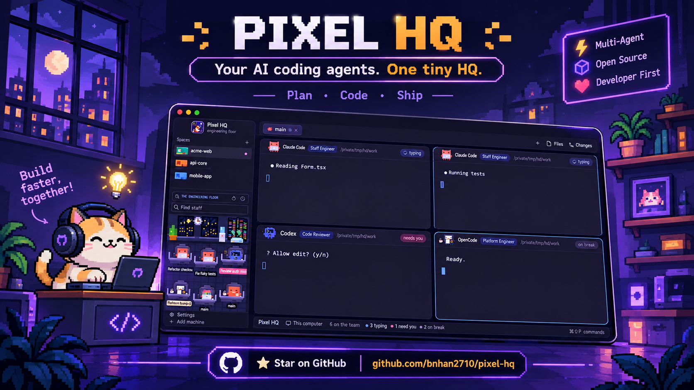

# Pixel HQ

Your coding agents as a small engineering company. Each agent is a pixel pet sitting on a chair
at its own desk with a MacBook, in a dark office. Its pane header is a desk nameplate with
its job title. Typing, on a break, shipped, needs you: all drawn.

This file is the brief: enough to build Pixel HQ from an empty folder. The files next to it are
one build of it. If they don't work on your Herdr, or you want it different, build it again from here.

## What you see

The Herdr window in a Catppuccin Mocha palette: dark blue-gray panels, light text, a soft blue `#89b4fa`
as the one accent. Panels are rounded (14px) with a faint white 1px border. A sidebar on the left,
tabs and terminals on the right, a status bar at the bottom.

- **Brand block** (top of the sidebar, 46px): the Pixel HQ logo (`mods/company-brand/logo.png`, a pixel-art corgi at a laptop in a rounded purple frame, 34px, transparent corners), "Pixel HQ"
  in semibold 14px and under it "engineering floor" in dim 10px. Search and sidebar-toggle buttons on the right.
- **Floors** (the spaces block, header "Spaces" with a + button): each top-level space is one floor, a 52px card (rounded 8, no outline).
  - Tile (54x40, rounded 6, 1px dark outline): a cut-away of one floor of the night office. Slate wall (a touch lighter while the floor has staff, `#2a2f52`) with a 3px band in the space's color (the one Herdr stores in `space.colors`) along the top, a window with a city skyline, a moon and a few lit panes (brighter while an agent in the space is typing), a small LED screen of colored code lines (some blink while someone types), and a tiled floor with one desk per agent, up to three: a chair, a 8x7 pet in its own colors (crab orange, robot blue, penguin dark with a white belly, Antigravity orange over blue, other agents cream) and a laptop that glows white. A blocked agent's laptop glows pink with a blinking amber `!`; a done agent gets green and yellow sparkles. Empty desks show a dark laptop.
  - Line 1: the space name, semibold. Line 2, dim 11px: the git branch (or the folder name without git), a dot, and "N staff" or "empty",
    then green up and red down arrows for ahead and behind.
  - Right edge: one 8px dot. Blue while someone is typing, pink and softly pulsing when an agent needs you, nothing otherwise.
  - The active floor gets the shipped selected background. Worktree spaces keep the shipped compact tree rows; drag to reorder, the right-click menu
    and the collapsed rail work as in the shipped mod.
  - The mod resizes its own block (`layout.resize`) to `31 + floors x 54 + 20` px, between 100 and 380, plus 56 per remote machine, so the
    office gets the rest; more floors than fit scroll. The layout file starts it at 104px.
- **Pixel header and search** (above the office): a 30px plaque with a notched 2px frame (`#45475a`, corners cut) on a `#181825` fill and a hard 2px `#11111b` shadow below. It holds the corgi logo (24px, the same `logo.png`), "ENGINEERING FLOOR" in JetBrains Mono bold 10px caps in `#89b4fa`, then the needs-you bell (only while someone waits), the figures and sort buttons.
- **Find staff** (32px, 10px side margins, same notched frame on `#11111b`, frame turns `#89b4fa` while typing): a hand-drawn pixel magnifier (11 rectangles of 1.5px), the placeholder "Find staff" in mono, and while there is text "matches/total" and an x button. A pet matches when every word of the query appears in its tab or title text, space name, program name, job title (staff engineer, code reviewer, platform engineer, systems architect) or a status word (typing/working, idle/break, shipped/done, needs you/blocked). Pets that do not match drop to 14% opacity and matches get a yellow nameplate; Enter focuses the first match.
- **Status bar** (28px): "Pixel HQ" in lavender, machine, git branch, "N on the team", then colored dots:
  "typing", "need you" ("needs you" for one; the pill is a button that opens the needs-you popup), "shipped", "on break". On macOS the Dock icon also carries the needs-you count as a red badge (`setBadge`), and it clears itself.

## The pets

One species per agent program, picked from `program.key`:

| Program | Pet | Job title |
| --- | --- | --- |
| Claude Code | orange crab (`#D97757`, claws and legs `#B5593B`) | Staff Engineer |
| Codex | blue terminal robot: cloud-shaped head, dark screen face with `>` and a blinking `_`, chest panel | Code Reviewer |
| OpenCode | a round, chubby penguin (the one pet that is not a square): a 92-unit circle shaded from slate blue (`#4A5B80`) at the top to deep navy (`#262F44`) at the bottom with a light rim on the upper left, a white heart-shaped face that runs into a round belly, big dark eyes with white highlights, pink cheeks, a small amber beak, a two-feather tuft on top, navy flippers and two flat amber feet. No badge | Platform Engineer |
| Antigravity (`agy`, program key `antigravity`) | a small astronaut with a cube head: top face red to orange, a narrow left face and a wide right face blending orange, yellow and green into teal and blue. Big glossy eyes with a white highlight and pink cheeks on the wide face; the narrow face carries a soft vertical edge. A short pale-blue neck ring, a round blue-to-green torso with the Antigravity arch logo on the chest (right of center, no plate, thin pale halo), orange arms and boots. The laptop lid shows the tiny rainbow arch instead of the white apple | Systems Architect |
| Hermes Agent (`hermes`) | a charcoal herald (`#2F3346`, claws and legs `#22263A`, light eyes `#F5F1E6`): the square body with a gold helmet band across the top (24 units `#E8B04A`, a 6-unit `#B8862E` brim, a lighter `#F4CB6E` stripe in the middle) and a three-tier white wing (`#F5F1E6`, lowest tier `#C9C3B4`) at each side of the helmet, inside the body's 250 units. The wings flap together (`top` 0 to -5 units, 1100 ms; 520 ms typing; 240 ms cheering or urging). Gold badge | Chief of Staff |
| anything else | sheep: cream wool, brown face | the program's name |

All are blocky, front-facing, built from rectangles. The body is 200x200 units, claws 25x40 at the sides,
legs underneath; a property room on the left holds desk props. Claude's crab wears a company badge on
a lanyard; the robot has its own chest screen and wears none.

| Status | What the pet does | Pane chip |
| --- | --- | --- |
| working | sits behind a silver MacBook: the lid faces us with a glowing white apple, the screen's light tints its face, claws take turns typing, body bobs | "typing" blue, spinner |
| blocked | waves its right claw, an amber `!` blinks beside it (`!!`, faster, after a minute) | "needs you" |
| done | claws up, hops, amber sparkles twinkle, and seven pixel confetti pieces (yellow, pink, green, blue, violet, orange, teal) fall over the desk until someone looks | "shipped" green |
| idle | stays at its desk, eyes closed, a mug with steam beside it. Every 14 to 32 s one idle pet (picked at random, never two at once, only if unseen under 2 m, so a snoozing or urged pet stays at its desk) glides out beside its desk (one pet-width plus about 30px sideways, clear of the cubicle panels, and a step toward the viewer, 0.8 s), stays out for about 8 s and glides back. Past 2 m it snoozes with floating pixel Zzz; past 5 m a retro alarm clock rings beside the desk, the pet fidgets nervously with a sweat drop, and its nameplate turns peach urging work. Both thresholds count from the later of the last state change and the moment you last left that agent's pane (kept across restarts); while its pane is focused the pet stays on its plain coffee break, and the nameplate keeps showing the true idle time. Clicking a snoozing or urged pet nudges it awake (a hop, sparkles flash and a brief "nudged! ⚡" chip) and focuses its pane. A pet being dragged stays put | "on break" dim |

## The office

The back wall is a slate night office, left to right: a potted plant, a window with a moon, a round clock, a second window, a water cooler, and a short server rack (about as tall as the desk and monitor; a lit top cap with a tiny status graph, a retro pixel boombox on top with floating notes while audio plays, units with drive bays, vents, a fan or a network switch whose ports blink, each with a glowing status light and some blinking), next to a slim modern desk standing on the baseboard (light top, thin dark legs, a glowing LED strip underneath, a hanging white drawer) with a monitor on it showing a code editor (title bar with three dots, a line-number gutter, colored lines of code, a minimap, a live log pane of a worker processing data: finished batches in green, the current one blinking amber, text that flickers as it streams, a progress bar with a blinking frontier and a throughput meter; a running pill and a status bar, a blinking cursor) under a slowly shifting pink-to-cyan RGB bar, a backlit keyboard, a mouse and a steaming mug. Below it is a dark tiled floor with window light. Every pet sits on a grey office chair with a headrest and armrests, behind a steel-grey desk with cubicle panels on both sides.

Desks adapt to the team. Desks sit on a fixed grid, one desk per cell, with as many columns and rows as fit at the current size: up to four agents get full-size desks, and more agents shrink every desk (never below 0.42x) and add columns and rows until all fit, with each name label as wide as its column (full text in the tooltip). Nobody is ever hidden unless the panel is too small even at the smallest size, then a badge counts the rest.

## OpenCode status plugin

OpenCode 1.x does not report a status, so Herdr would not list it as an agent; OpenCode 2.0.29 and later report it themselves. `mods/company-agents/opencode-status.js` is an OpenCode plugin that, on 1.x, writes the OSC 7501 sequence (`ESC ] 7501 ; state=<working|idle|blocked>:app=opencode ESC \`) to `/dev/tty`: idle when it loads, working on session status `busy` or tool calls, blocked on a permission or question, idle on `session.idle`; sub-agent sessions are ignored.

One file loads on every OpenCode. It exports the 1.x factory as `PixelHqStatus` and a default object `{ id: "pixel-hq-status", server, setup }`:

- OpenCode 2.x needs a default object with `id` and `setup` (it rejects a function) and ignores other keys. `setup` does nothing, and the terminal is never opened.
- 1.3.13 to 1.19 see a default object with `id` and run its `server`.
- 1.0 to 1.3.1 call every export: `PixelHqStatus` runs, then calling the object logs one load error.

On first run the `company-agents` mod copies it, with `exec("sh", ...)`, to `$XDG_CONFIG_HOME/opencode/plugins/` (default `~/.config/opencode/plugins/`) when that folder exists and the file does not, records that in `localStorage` (`oc-plugin`), and shows a dismissible note: "OpenCode plugin added · restart OpenCode to see it here". A file there that has the first release's `PixelHqStatus` but not `pixel-hq-status` is Pixel HQ's own old copy, which 2.x refuses to load: it is replaced, with the note "OpenCode plugin updated · …". Any other file is left alone, and when the first release's record (`oc-plugin`) exists a missing file is not added back, since the person removed it. On Windows the same copy is done with `powershell` (config folder `%XDG_CONFIG_HOME%\opencode`, else `%USERPROFILE%\.config\opencode`) and the plugin writes to `\\.\CONOUT$` instead of `/dev/tty`. The PowerShell copy has been run on Windows; the plugin's `\\.\CONOUT$` output has not been tested on a real Windows machine.

## OpenCode HP plugin

`mods/company-agents/opencode-hp/` is a directory package: `tui.tsx` carries the plugin and `server.ts` is a no-op, so the server side stays quiet too when the folder is auto-discovered. OpenCode TUIs auto-discover directory packages under their plugins folders — the global one (`~/.config/opencode/plugins/pixel-hq-hp/`) applies to every TUI, whatever project it runs in — and hot-reload them on save, so no restart is needed once the folder exists. One plugin, every generation: 2.x loads `setup` (its plugin runtime; the sidebar's exact `contextUsage` math against the last assistant message after the last completed compaction and the location's `model.list` `limit.context`, recomputed on `session.usage.updated` and every 4 s), 1.x loads `tui` (the `@opencode-ai/plugin/tui` API; the same token math over the finished assistant message carried by `message.updated`, whose `limit.context` comes from `client.config.providers()`, falling back to `api.state.provider` when the client does not expose it), and pre-1.3.13 calls the exported `PixelHqHp` function (same code path as `tui`). Both generations label the terminal with `agent.context` and `agent.model`, only when the number moved. The desk's HP bar and papers follow along as usual. The first-line marker `pixel-hq-opencode-hp v2` identifies Pixel HQ's own copy: the mod replaces it with a newer one when the marker differs and never touches anything without it. On first run the mod installs the folder alongside the status plugin (PowerShell on Windows), remembers that in `localStorage` (`oc-hp-plugin`) and shows "OpenCode HP plugin added". Deleting the folder removes it for good. The 1.x status plugin keeps its own copy of the HP labels, so even ancient 1.x desks carry the HP bar (the TUI plugin path needs a 1.x TUI with a plugin host).

## Needs you and settle

- **The bell.** When any agent on any floor or machine is `blocked`, a pixel bell (11 rectangles, `#f9e2af`) appears in the header plaque with a pink count badge. Click it and a popup lists every agent across every space and machine that waits on you, longest waiting first: the pet (amber wave), the terminal title with leading symbols stripped, then `space · program · waiting Nm`. Click a row and Herdr focuses that pane; the popup closes itself (Esc closes it too). The pill in the status bar opens the same popup. The command `company-agents.needsYou` opens it too. Live updates: the list is re-derived on every render, so it empties itself as agents are answered.
- **Settle.** A green `#a6e3a1` ✓ button sits at the top-left corner of every shipped (`done`) desk, above the chair. Click it and the pet clocks out: the desk leaves the floor (kept in `localStorage` as `settled`, so it survives restarts) and its confetti stops. The pet comes back on its own the moment the agent works or waits on you again (the entry is dropped). While at least one settled pet is off the floor a `✓ N settled` chip shows at the top-right of the office; click it to bring everyone back at once. When every visible pet has been settled, the empty floor says so instead of "No staff on this floor yet".

## HP/SP vitals

Under the branch line of every desk whose cell is at least 90px wide, two thin (3px) bars span the desk's nameplate width: **HP** on top, **SP** below. HP is context used, drawn like Claude's status line: green, yellow from 60%, red from 80%. SP is the share of the quota window left: blue while plenty, amber from 30% left, red from 10%. The pile of papers stays as it was. Hover any desk for the exact numbers (`Context N% used · M% of the quota window left · model · effort`). The branch line now also carries the model and its effort in dim text after the branch (e.g. `main · Opus 5.5 · high`). Desks too small for the bars keep the tooltip only; desks that carry vitals get +11px of cell height so nothing clips.

Where each number comes from: **Claude** feeds both through `claude-statusline.sh` (see "Paper pile and /compact"): it labels the terminal with `claude.quota` (`100 - rate_limits.five_hour.used_percentage`, 0-100) and `claude.effort` (`effort.level`), next to the existing `claude.context` and `claude.model`. **OpenCode** feeds HP through the same status plugin on 1.x and through the TUI HP plugin on 2.x (see above); it has no plan-quota source there, so no SP bar and no effort. **Codex** feeds HP only (its session file; no plan-quota source either). **Antigravity** feeds HP through its transcript (`input_tokens + cache_read_tokens` over a 1M window, found via the CLI's `history.jsonl` workspace match — no lsof or sh needed, same on every platform) and SP through `mods/company-agents/agy-quota.py`: every quota refresh (at most once a minute, cached in the mod) it refreshes the Antigravity CLI's OAuth token itself when it aged out (talks to the same `cloudcode-pa` endpoint the CLI uses; `AGY_HOME` is honored for a non-standard CLI install, default `~/.gemini/antigravity-cli`), asks `fetchAvailableModels` for the models available to the account and prints the tightest `remainingFraction` across them as a percentage of quota left (the `chat_`/`tab_` plumbing is skipped). The script carries no credentials of its own: it reads the public OAuth pair from the installed `agy` binary on first use and caches the working pair under `~/.cache/pixel-hq/agy-oauth.json` (file-private), so nothing secret-shaped lives in this repo. The mod survives the call failing and keeps the last good number for the session; it tries `python3`, then `python`, then `py` on Windows. Works on macOS, Linux and Windows. Effort stays a Claude-only number. The vitals are also drawn in the grouped rows view when it is shown.

## The living wall

`scene(W, H, opts)` draws the wall from `opts = { music, now, spaces, needYou, load, shipped, droop }`; `sceneLayout(W, H)` returns where everything is (windows, buildings, clock, sign, rack cabinet, water cooler, plant), so `main.js` puts clickable spots exactly over the drawing. The office copy redraws once a minute for the clock.

- **Time of day** (`phaseOf(now)`): dawn 5:00-7:30 (sky `#3d2f5e`, city `#1f2342`), day 7:30-17:30 (`#4f86c6`, `#2d3d6b`), dusk 17:30-20:30 (`#5a3358`, `#22213f`), night (`#0e1226`, `#161b36`, twinkling stars). One 8-unit sun (`#f9e2af`, orange `#fab387` at dawn and dusk, a soft halo by day) or moon (`#d9cf9a`) crosses both windows from left to right on an arc: the sun from 5:00 to 20:30, the moon from 20:30 to 5:00. The light pools on the floor are warmer and brighter by day.
- **Clock:** the face as before, an hour hand (3px steps) and a minute hand (2px steps) at the local time, a red centre.
- **Buildings = spaces:** the 6 buildings per window in order, one per entry of `spaces()` (extra spaces get none). Lit windows (`#e0b94a`, 2 columns, up to 4 rows): working most of them, twinkling faster; blocked half; done or idle one; buildings without a space a few at night only. Blocked: a red `#f38ba8` beacon blinking on the roof (480 ms); done: a steady green `#a6e3a1` one; the shown space: a 2px `#89b4fa` roof line.
- **Sign** (32x32 under the clock, only when the gap between the windows is at least 44 and there is height): agents blocked across all spaces as a red number (`#f38ba8` on `#3b1d2b`, a blinking red frame, "NEED YOU" below); none: a green check. No room: a 12x10 red badge with the count on the clock's lower right.
- **Board:** `sceneLayout().board`, under the windows from `x0 - 2` to the water cooler (`cw - 8`), 16 px tall, centered between the sill and the baseboard; only with 30 px there and 96 px of width. A `#0a0c1a` bezel, `#14110c` face (1px `#3a2f1c` border), three faint scanlines and two bolts. Left, when any live agent reports a quota: five 3x8 segments (20% each) for the lowest, green `#a6e3a1`, amber `#f9b84a` at 25% or less, red `#f38ba8` and blinking at 10% or less. Right, JetBrains Mono bold 7.5 px amber text through `.frames(list, 250)`: each panel holds 3 s, and one longer than the board (4.55 px a character) scrolls a character a frame. Panels: the last three events within 6 h (`WHO SHIPPED 4M`, `WHO WAITED 1H`, logged in `track()` when a desk goes working to idle or anything to blocked, kept in localStorage), `N SHIPPED TODAY`, `XhYYm AT WORK`, `WHO CONTEXT 87%` (80% and up), `N HELPERS AT WORK`. While anyone is blocked: one red panel `! WHO NEEDS YOU`, a red border blinking. The tooltip lists every panel and each agent's quota and reset time. The sign under the clock now shows only while someone needs you.
- **Zoom:** `on_size_change` reports window pixels, while drawing is in the mod's units (scaled by `settings().zoom`); divide the size, and drag offsets, by the zoom, or the wall overflows its right edge.
- **Rack:** its first `load` units' lights turn green and blink fast (220-460 ms); `load` = interns + shell jobs over every agent.
- **Plant:** a little potted tree, never a single tall stem (that reads as a cactus). A 3x22 trunk (`#6b4a32`, a 1px `#8a6444` edge) from the pot; a crown cluster (16x12) on top; then one more branch per step at 1, 4, 8, 13, 19 and 26 tasks shipped today (seven at most, alternating left and right, each a line of 2px bark steps from the trunk to an 11x9 cluster). Clusters are rounded blobs: dark `#2f6e3b`, mid `#3a8247`, three light `#5fb06b` leaves. From 30 tasks each cluster gets a pulsing pink `#f5c2e7` blossom. `droop` sags the tips 3 to 6 px and yellows the leaves (`#6e7a3a`, `#7d8a40`, `#a3a852`).
- **Water cooler:** a bubble rises in the jug every 2.6 s.
- **Today:** `track()` calls `tally()` whenever an agent stops working: its working time (from midnight at most, 6 h at most) is added to the day and to its space; working to idle or done counts one task shipped. Kept in localStorage (`today`) and shared as `pixel-hq.today` for the popup; a new day starts over.
- **Clicks:** building, `space.select`; sign or badge, the needs-you popup; clock or plant, the TODAY popup (tasks shipped, time agents worked as `Xh Ym`, busiest floor, working now, waiting on you); rack cabinet, the SERVER RACK popup (desks with sub-agents or shell jobs, busiest first, a click runs `agent.focus`); water cooler, settles every `done` agent. Each spot stops the press so it never drags a pet.

## Interns and server rack

How much is going on at a desk, drawn without new moods:

- **Interns:** one tiny pet per running sub-agent at the front of the desk, over its front panel: height `max(12, round(PET * 0.38))`, bottom-aligned with the desk's bottom edge (`PET * 0.84 + 22 units`), left from 2 units in, `round(iw * 0.62)` apart (`iw = duckWidth(ih)`), three at most, then a `+N` tag (`#0f111acc`, `#cdd6f4`). Each is drawn with `duckMood(mood(status, 0), ih, { species })`. Sources: Hermes' `agent.threads` label (all `working`, herald species), plus every live terminal whose `parent` is the desk's terminal (its own program's species and status).
- **Server rack:** only while `agent.jobs > 0`, a 9-unit slim tower (`#161827`, 1px `#2e3250`, rounded 2) on the right cubicle panel (`left petW + 2`, `top PET * 0.3`, height `PET * 0.66`), one 5x3 LED per job (as many as fit, 5 units apart), green `#a6e3a1`, the first `agent.jobs_long` amber `#f9b84a`, each blinking (`opacity 0.3 to 1`, 360 to 780 ms, staggered).
- **Runners:** only while `agent.jobs > 0`, one helper bot per job (three at most, then a `+N` tag), sized like an intern (13 units of `max(1.4, PET * 0.4 / 13)` px) on the floor below the desk (`top PET * 0.84 + 22 - height + 13` desk units, odd ones 2 units lower). Each paces between `ctr - 4` and `petW + 4` with `loop("left")` (1700 ms + 600 per runner, alternate ones starting from the other end), hops with `loop("top")`, swings two legs in opposite phase with `loop("height")`, and carries a parcel (`#e9d8b4`). Its head is green `#a6e3a1`, amber `#f9b84a` for the first `long` jobs.
- **Long jobs:** `long = min(jobs, max(agent.jobs_long, count of agent.jobs_started times over 60 s old))`. The start times are for reporters that only run when a job starts or ends (the Claude Code hook); the mod's 30 s redraw turns them amber.
- **Sources:** any agent's labels, not only Hermes'. Claude Code reports through `claude-activity.py` hooks (Bash Pre/PostToolUse for jobs, SubagentStart/Stop for `agent.threads`, cleared on turn end and session start/end).
- **Pace:** `figureFor(..., species, pace)` passes `pace = 1 + min(1, 0.25 * (interns + jobs))` to `duckMood`, which divides the typing periods (claws 240, body bob 480, screen glow 900, Hermes' wings 520) by it.
- **Tooltip:** `· N sub-agents · N shell jobs (N over a minute)`.

The Hermes plugin keeps per-desk counts: sub-agents from `subagent_start` until `subagent_stop` (dropped after 2 h), `terminal` / `execute_code` calls by `tool_call_id` from `pre_tool_call` until `post_tool_call` (all cleared at the turn's end, so a missed hook never leaves a light on), and running background processes from Hermes' process registry (`tools.process_registry.process_registry._running`, matched by the desk's session keys). A thread labels each desk every 2 s when the numbers change, only in the process that saw the desk's work: Hermes runs every session's agent in its gateway, even the classic CLI's.

## Paper pile and /compact

`claude-statusline.sh` (set as Claude Code's `statusLine`) reads the JSON Claude passes on stdin, takes `context_window.used_percentage` (else estimates it from the last usage in the transcript) and runs `hc label $HC_TERMINAL_ID claude.context=<0-100> claude.model=<name>` (plus `claude.quota` and `claude.effort` when the JSON carries them — see "HP/SP vitals"). The agents mod reads that label from `terminals()` (`agent.context`, else `claude.context`; and `agent.model`, else `claude.model`). Three other agents feed the same number: **OpenCode**, two paths — **1.x** (the status plugin, version marker `pixel-hq-plugin v3`, reads `message.updated` events of the root session: `input + output + reasoning + cache.read + cache.write` of the last assistant message over the model's `limit.context` from `client.config.providers()`, and labels the terminal with `hc label $HC_TERMINAL_ID agent.context=<pct> agent.model=<id>` at most every 3 s) and **2.x** (the TUI HP plugin, marker `pixel-hq-opencode-hp v2`, the same token math over the last assistant message after the last completed compaction — exactly the sidebar's `contextUsage` — against the location's `model.list` `limit.context`, recomputed on `session.usage.updated` and every 4 s, labelling only when the number moved; on 1.x the same file labels from `message.updated` against `client.config.providers()`), **Codex** (every 8 s the mod runs a small `sh` script: it finds the session file a Codex process or one of its children has open with `lsof`, else the newest rollout under `$CODEX_HOME/sessions` whose first line has the desk's `cwd`, takes its last `token_count` event and divides `last_token_usage.total_tokens` by `model_context_window`; macOS and Linux only), and **Antigravity (`agy`)** (every 8 s the mod takes the workspace's last conversation from `$AGY_HOME/history.jsonl` (default `~/.gemini/antigravity-cli`) — pure file reads, works on macOS, Linux and Windows — then reads the last usage line of its transcript at `brain/<cid>/.system_generated/logs/transcript.jsonl`, takes `input_tokens + cache_read_tokens` over a 1M token context window, and reports its model; at most once a minute it also refreshes the SP quota through `agy-quota.py` — see "HP/SP vitals"). When the installed OpenCode plugin carries an older marker the mod replaces it with its own newer version (never a file that is not this plugin). For an agent with the label at 5% or more it draws, on the right of the desk, a pile of `ceil(pct/10)` sheets (max 10), each 15x3 units, alternating `#f6f1e7` and `#e9e2d4` with a faint bottom edge and a 1-unit sideways wobble; from 80% the two top sheets are pink (`#f5b8c0`, `#f0cbd0`), from 95% the whole pile bobs 2 units every 0.6 s. The pile is a click target (tooltip: "Context N% used · click to /compact"). Click one arms it (the nameplate turns violet and reads "click the papers again to /compact" for 6 s); a second click within that time runs `hc send <terminal> "/compact"` (Claude Code's /compact already summarizes, so no extra instruction), and the nameplate reads "compacting..." for 8 s. A `working` agent answers "busy: wait for it" and a `blocked` one "answer it first", and nothing is sent.

## The metro line

The Spaces block is a metro: one line per machine, one station per space (the machine's own line first). A line starts with a square notched badge in the line's color holding the machine's first letter, "THIS COMPUTER LINE" in mono bold 10px caps, a station count and a fold chevron, on a `#181825` bar with a 2px underline in the line color. The track is a 4px line in a soft pastel (periwinkle `#8fa3f0` for the first line, then `#7aa7e8`, `#6fc7bd`, `#b394f0`, `#8fcf94`, `#e49ac8`) with a 1px highlight and dark 2px sleepers every 8px. Each station is a 14px square with notched corners in the line color and a white core; the shown space's core is warm yellow with a soft pulsing halo, and a blocked agent turns it pink and pulses faster. A small train (a 10x14 white car with a window and a headlight) rides up and down the track beside a station while its agents are working. A dashed square ends the line ("new station").

Each floor card is 66px: the night-office tile (54x40, as above) inside a notched 60x46 frame in the space's own color; the name (semibold 13.5px) with a small pulsing square when something is happening; a mono 10.5px line with a git-branch glyph and the branch (blue) or folder (dim), `· N aboard` or `· no service`, and the ahead/behind arrows; and a row of status chips, most urgent first (`N needs you` pink and pulsing, `N typing` blue, `N shipped` green, `N break` gray), or "dark floor" when nobody is there. The shown floor gets the selected background and a 3px bar in the line color at the left edge.

## Worktrees, clashes and floors

`mods/company-agents/crew.js` holds the git logic; the mod passes it Herdr's `exec`.

- **Floors apart:** the office lists only the agents whose `space` is the shown space (`spaces()` `active`). The Spaces cards still count every space's staff.
- **Branch tag:** under each desk's name pill, `branch` from `panes()` for the agent's pane, in mono 9.5px `#89b4fa` after a 8x10 git-branch glyph drawn from five rectangles. It adds 15px to a desk's height when any visible agent has a branch.
- **Scan** every 6 s (remote machines' spaces skipped): for each agent's pane `cwd` run `git rev-parse --show-toplevel`, `git rev-parse --path-format=absolute --git-common-dir` and `git status --porcelain=v1` in the top. Two desks whose common dir is equal but whose tops differ and whose changed-file sets intersect are a **file clash**; two working agents (`status` working) with the same top (or the same non-git `cwd`) are a **folder clash**. The result is kept only when it changes.
- **Look of a clash:** a lightning bolt (5 rectangles) blinking over the pet's head, red `#ff5370` for a file clash and amber `#f9b84a` for a folder clash; the name pill turns that color and reads `clash: <file>` (plus `+N`) or `same folder`; a dotted line of 4px squares every 10px, blinking at different rates, joins each clashing pair on the floor; the tooltip lists the files.
- **Hire:** a 14px pixel `+` in the header plaque toggles a framed form (same notched frame): ticket input, repo input (default: the space's folder, else the focused pane's), five program chips (claude, codex, opencode, agy, hermes; they wrap) and Hire / Cancel buttons. Hire validates the ticket (`^[A-Za-z0-9][A-Za-z0-9._/-]*$`, no `..`, no trailing `/` or `.lock`), finds the repo's top, makes `<top>/../.worktrees/<repo>-<ticket with / as ->` with `git worktree add -b <ticket>` (or without `-b` when the branch exists; an existing worktree at that path is reused), then runs `tab.new { name: ticket, folder, argv: [program], space: <shown space> }`. Errors show in red inside the form. The command `company-agents.hire` opens the form too (bind it to a key).

## Update notice

`company-agents` checks `mods/company-agents/version.json` on startup and every six hours. The status bar offers newer releases, and **Changelog** shows the changes from your installed version to the available version, or the changes from your last in-app update. Clicking the update pill or running `company-agents.update` downloads the release in the background, writes changed files, and saves the new version once those writes finish. The updater can resume an install after a mod reload and clears expired update state. A toast shows the result.

## Built from

- **The layout** (`layouts/pixel-hq.json`): a root `row` with `theme: "pixel-hq"`, `padding: 8`, `gap: 8`, `background: #11111b`,
  `titlebar: "none"`, `traffic_lights: [12, 16]` and these `colors`: accent `#89b4fa`, chrome `#181825`,
  canvas `#11111b`, background `#1e1e2e`, surface `#262637`, raised `#313244`, border `#ffffff14`.
  Children: a `sidebar` column (brand block 46px, spaces block, agents block, footer block) and a `work`
  column (tabs block 42px, the terminals block `{ tab: "active", pane: { … } }`, a files/changes panel, status block 28px).
  The pane frame: radius 14, gap 8, background `#1e1e2e`, 1px border, focus border `#89b4fa`,
  header `{ mod: "company-pane", height: 40 }`.
- **Theme** (`themes/pixel-hq.json`): background `#1e1e2e`, foreground `#cdd6f4`, cursor `#89b4fa`, the Catppuccin Mocha 16-color ANSI set.
  The layout names it as a single theme, not a `{light, dark}` pair: its panels are painted dark, so with the system (or `appearance`)
  in light mode a light theme would put dark text on them.
- **`mods/company-brand/`**: the shipped `workspace-chrome` header with the logo tile and two-line name. Its search and sidebar-toggle
  icons (`search.svg`, `sidebar.svg`) are copies of `workspace-chrome`'s, so the mod does not depend on another mod's files.
- **`mods/company-pane/`**: a pane header. Reads `panes()` for its terminal; draws the pet with `duckMood`
  from its own `duck.js`; chip colors come from the status.
- **`mods/company-status/`**: counts from `agents()` by status.
- **`mods/company-spaces/`**: the shipped `spaces` mod with a floor card instead of the one-line row. It reads `agents()` and groups by `agent.space`.
- **`mods/company-agents/`**: the agents block: `agents()` for the team, `setAgentOrder` on render, `run("pane.focus")`
  on click. The room is `scene.js` (rectangles plus a few `.loop()` twinkles), the pets are `duck.js`.
  Drag uses `on_mouse_down` on a pet and `on_mouse_move` / `on_mouse_up` on the room, positions stored in
  `localStorage` as fractions of the panel. While dragging, the desk follows the pointer; on release it drops into the
  nearest free grid cell and every other desk is pinned to the cell it shows in, so nothing else moves. Desks never
  dragged fill the free cells left to right, top to bottom, and every render snaps saved positions to the nearest cell,
  so a resize keeps the grid aligned.
- **Motion:** only native `.loop()` and `.spin()`, no timers.
- **Font:** the terminal and UI use whatever Settings says; the build was made with JetBrains Mono NL Medium at 14.

## Install

Copy `layouts/`, `mods/` and `themes/` into `~/.config/herdr-app/`, then pick **pixel-hq** in Settings > Look;
it brings its own **pixel-hq** theme. Quit and reopen Herdr once so it loads the new mods.

Credits and licenses: see `NOTICE.md`.
